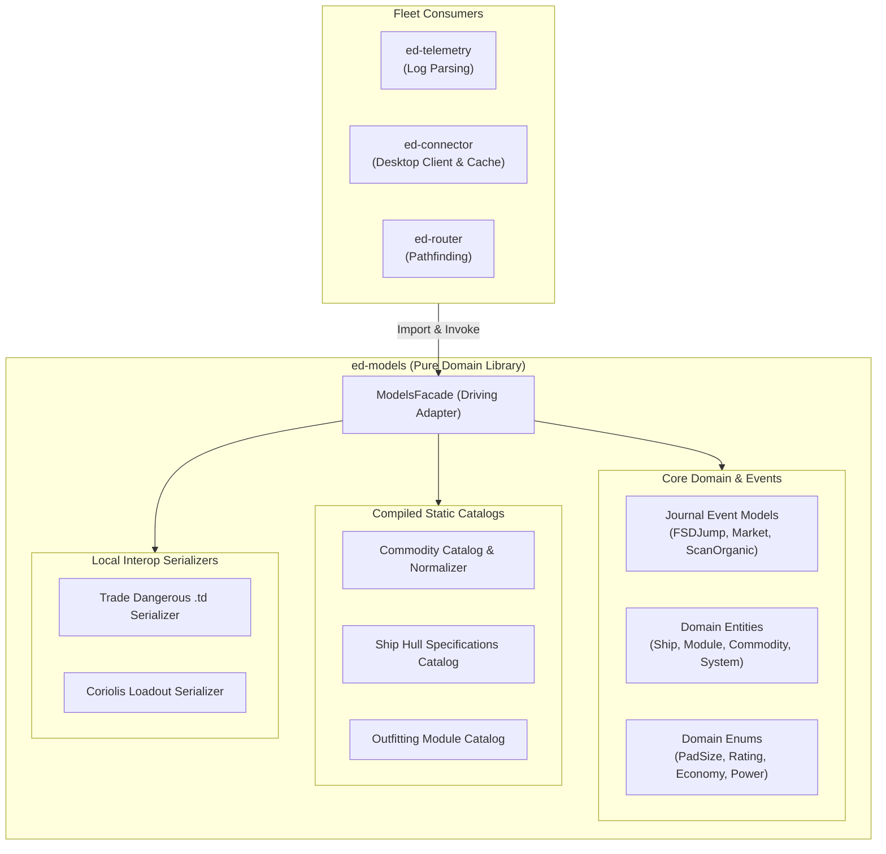

# ADR 0001: ed-models Pure Domain Architecture, Catalog Codification, and Driving Facade

* **Status:** Proposed
* **Deciders:** Elite Dangerous Fleet Architecture Team
* **Date:** 2026-10-31

---

## 1. Context and Problem Statement

Across the *Elite Dangerous* software fleet (`ed-telemetry`, `ed-transport`, `ed-schema`, `ed-connector`), companion applications require rich representations of game entities:
- Frontier Journal events (`FSDJump`, `CarrierStats`, `Market`, `ScanOrganic`).
- Game domain objects (Ships, Outfitting Modules, Commodities, Minor Factions, Powerplay states).
- Normalization tables translating internal Frontier tokens (`$grain_name;`) to canonical game terms.
- Static specifications (hull mass, landing pad size classes, module masses/ratings) missing from raw journal logs.

Currently, data definitions are fragmented across external CSVs, ad-hoc Python dictionaries, and third-party API wire DTOs. 

We need a centralized, deterministic domain foundation: the planned **`ed-models`** library. We must establish its operational boundaries, ensure it remains strictly decoupled from network transport and third-party wire formats, and define its external integration surface.

---

## 2. Decision Drivers

* **Pure Domain Boundary:** The library must be 100% focused on game logic and domain entities, completely free of network I/O, HTTP clients, ZeroMQ sockets, or transport protocol logic.
* **Separation of Domain vs. Wire:** Wire DTOs and remote API contracts (EDDN schemas, Inara InAPI DTOs, Spansh OpenAPI models, CAPI schemas) belong in `ed-schema` and `ed-transport`, not in `ed-models`.
* **Zero Runtime Network Requirement:** Must provide 100% offline functionality out-of-the-box by bundling pre-compiled static catalogs.
* **Library Package (Not Standalone):** `ed-models` will not have a CLI, daemon, or standalone application runner; it will be an embedded dependency library.
* **Hexagonal Architecture:** Must expose a clean, unified driving facade adapter (`ModelsFacade`) hiding internal collection structures and normalization mechanisms.

---

## 3. Considered Options

* **Option 1: Monolithic Domain & Wire Library.** Combine game domain entities with external API DTOs (EDDN, Inara, Spansh, CAPI) in a single package.
* **Option 2: Raw Datafile Consumer.** Have `ed-models` read raw CSV/JSON files from disk on every invocation at runtime.
* **Option 3: Pure Hexagonal Domain Library with Compiled Static Catalogs and Driving Facade (Selected).** Codify all game logic, raw journal event definitions, enums, and static catalogs into immutable Python types, exposed via a `ModelsFacade`.

---

## 4. Decision Outcome

**Chosen Option:** **Option 3: Pure Hexagonal Domain Library with Compiled Static Catalogs and Driving Facade.**

### 4.1 Boundary Invariants
1. **No External I/O or Wire Schemas:** `ed-models` will contain **zero** references to EDDN, Inara InAPI, Spansh REST endpoints, or Frontier CAPI wire wrappers. It models the *in-game universe* as defined by Frontier Developments, not external web servers.
2. **Library-Only Packaging:** Distributed strictly as an installable Python library (`pyproject.toml`). No CLI console scripts, daemons, or executable entry points.
3. **Pre-Compiled Static Catalogs:** Tabular community datafiles (`commodity.csv`, `ships.json`, `modules.json`) are compiled into frozen dataclasses and `StrEnum` instances at build time (as detailed in Note 0006).
4. **Primary Responsibility for Game Emission Models:** `ed-models` is the **canonical owner of all game-emitted event models** across three distinct source file types:
   - **Journal Event Streams (`Journal.<timestamp>.log`):** Strongly typed models for discrete events (`FsdJumpEvent`, `LocationEvent`, `CarrierStatsEvent`, `ScanOrganicEvent`).
   - **Station & Market Snapshots (`Market.json`, `Outfitting.json`, `Shipyard.json`, `Cargo.json`, `NavRoute.json`):** Strongly typed state snapshots capturing starport market quotes, shipyards, outfitting inventories, and planned navigation routes.
   - **Real-Time Status Telemetry (`Status.json`):** Strongly typed vehicle status models unpacking raw 32-bit integer flags bitfields into ergonomic booleans (`status.flags.landing_gear_down`, `shields_up`, `in_supercruise`) and pips/fuel telemetry.
5. **Decoupled Boundary with `ed-schema`:**
   - **`ed-schema` Owns the Rules (Validation):** Houses Draft 04/07/2020-12 JSON Schemas verifying that raw JSON text emitted by the game or APIs is well-formed.
   - **`ed-models` Owns the Objects (Domain & Logic):** Houses the strongly typed Python dataclasses that instantiate validated dictionaries into routable, portable objects for consumption by `ed-connector` and `ed-router`.

### 4.2 Architecture Structure



### 4.3 Driving Facade Contract

`ed-models` exposes a unified entry point:

```python
from ed_models import ModelsFacade, create_models_facade

facade: ModelsFacade = create_models_facade()

# 1. Deterministic Token Normalization (FDevIDs)
commodity = facade.normalize_commodity("$grain_name;")
# -> Commodity(symbol="Grain", category=CommodityCategory.FOODS, id=128049102)

# 2. Static Domain Catalog Lookups
hull_spec = facade.get_ship_spec("anaconda")
# -> ShipHull(symbol="Anaconda", base_mass=400.0, pad_size=PadSize.LARGE)

module_spec = facade.get_module_spec(128049382)
# -> ShipModule(name="5A Frame Shift Drive", class_num=5, rating="A", mass=20.0)

# 3. Strongly Typed Journal Event Deserialization
event = facade.parse_journal_event(raw_json_dict)
# -> FSDJumpEvent(...)
```

### 4.4 Domain Area Scope & Storage Boundary Matrix

To guarantee a lightweight Python package (under 2 MB distribution footprint and under 10 MB active RAM usage), `ed-models` enforces an absolute architectural distinction between **Domain Definitions (Static Code & Blueprints)** and **External Datasets (Databases & Cloud Storage)**:

| Domain Area | ✅ WHAT IS IN `ed-models` (Static Code & Blueprints) | ❌ WHAT IS NOT IN `ed-models` (External Storage / Cloud) |
|---|---|---|
| **Star Systems & Bodies** | • `StarSystem` & `CelestialBody` dataclasses.<br>• `StarType`, `AtmosphereType`, `Volcanism` enums.<br>• Coordinate math: `Distance(sysA, sysB)`. | • The 200M system database (stored in Spansh, EDSM, or local SQLite). |
| **Commodities** | • Complete static `CommodityCatalog` (~450 items, tiny ~30 KB).<br>• `CommodityCategory` enum.<br>• Token normalizer (`$grain_name;` $\rightarrow$ `Grain`). | • Real-time fluctuating starport prices and stock supplies (queried via EDDN/Inara). |
| **Ships & Outfitting** | • Complete static `ShipCatalog` (all 48 flyable ships + base hull mass + pad size).<br>• Complete static `ModuleCatalog` (~150 module specs, slot sizes, ratings). | • The player's active ship inventory or remote fleet carrier cargo (managed in session state). |
| **Journal Events** | • Strongly typed models for all ~100 Frontier Journal events (`FSDJump`, `Scan`, `CarrierJumpRequest`). | • The historical log files on the player's disk (read by `ed-telemetry`). |
| **Factions & Politics** | • `Government`, `Allegiance`, `PowerState` enums.<br>• `MinorFaction` & `Powerplay` models. | • Galaxy-wide BGS influence percentages and current expansion states. |
| **Calculators & Interop** | • Ship mass & jump range formula.<br>• Coriolis JSON & Trade Dangerous `.td` serializers. | • The network requests to Spansh or Inara. |

---

## 5. Pros and Cons of the Selected Option

### Pros
* **Ultra-Fast In-Memory Lookups:** Zero runtime disk parsing or JSON unmarshaling for core lookups; operations run at native Python dictionary speeds ($O(1)$).
* **Guaranteed Determinism:** All fleet packages operate against identical, strongly typed enum and class definitions.
* **Complete Offline Safety:** Companion applications function seamlessly in offline environments (e.g. deep-space exploration without internet).
* **Clean Architectural Separation:** Isolates game universe mechanics from shifting third-party web API changes.

### Cons
* **Requires Upstream Build Pipeline:** When Frontier patches the game with new trade goods or ship hulls, `ed-models` must execute its automated codegen pipeline (Note 0006) to cut a patch release. *(Mitigated by runtime cache overlays in `ed-connector`)*.

---

## 6. Implementation and Migration Strategy

Before creating the standalone `ed-models` repository:
1. **Verification Sandbox (`ed-integration-smoke`):**
   - Gather domain research from `ed-telemetry/architecture/research/` (`ed-journal`, `ed-scout`, `target_files_metadata_spec.md`).
   - Collect and cross-reference model definitions from `EDCD/EDMarketConnector` and community sources.
   - Author a unified verification script in `ed-integration-smoke/scripts/` validating normalization accuracy and domain completeness across all Frontier tokens.
2. **Repository Bootstrap (`ed-models`):**
   - Scaffold repository under `~/src/github.com/mnaatjes/ed-models`.
   - Implement hexagonal structure: `core/`, `catalogs/`, `events/`, and `facade/`.
   - Bind existing fleet tests to verify contract compliance.
