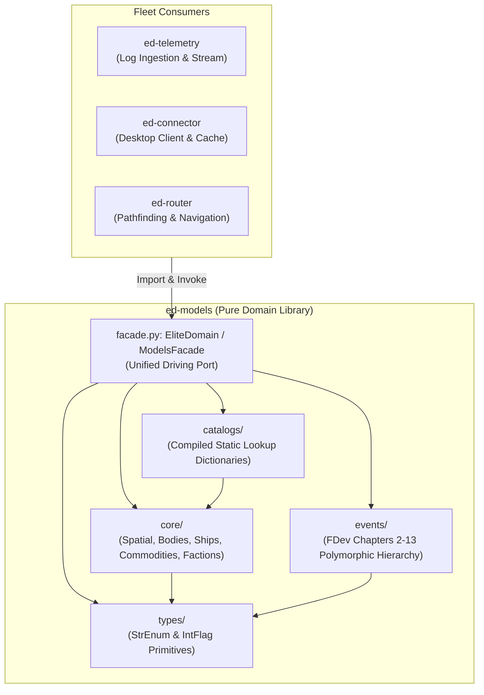

# ADR 0001: ed-models Pure Domain Architecture, Catalog Codification, and Driving Facade

* **Status:** Proposed
* **Deciders:** Elite Dangerous Fleet Architecture Team
* **Date:** 2026-10-31

---

## 1. Context and Problem Statement

Across the *Elite Dangerous* software fleet (`ed-telemetry`, `ed-transport`, `ed-schema`, `ed-connector`), companion applications require rich representations of game entities:
- Frontier Journal events (`FSDJump`, `CarrierStats`, `Market`, `ScanOrganic`).
- Game domain objects (Ships, Outfitting Modules, Commodities, Minor Factions, Powerplay states).
- Normalization tables translating internal Frontier tokens (`$grain_name;`) to canonical game terms.
- Static specifications (hull mass, landing pad size classes, module masses/ratings) missing from raw journal logs.

Currently, data definitions are fragmented across external CSVs, ad-hoc Python dictionaries, and third-party API wire DTOs. 

We need a centralized, deterministic domain foundation: the planned **`ed-models`** library. We must establish its operational boundaries, ensure it remains strictly decoupled from network transport and third-party wire formats, and define its external integration surface.

---

## 2. Decision Drivers

* **Pure Domain Boundary:** The library must be 100% focused on game logic and domain entities, completely free of network I/O, HTTP clients, ZeroMQ sockets, or transport protocol logic.
* **Separation of Domain vs. Wire:** Wire DTOs and remote API contracts (EDDN schemas, Inara InAPI DTOs, Spansh OpenAPI models, CAPI schemas) belong in `ed-schema` and `ed-transport`, not in `ed-models`.
* **Zero Runtime Network Requirement:** Must provide 100% offline functionality out-of-the-box by bundling pre-compiled static catalogs.
* **Library Package (Not Standalone):** `ed-models` will not have a CLI, daemon, or standalone application runner; it will be an embedded dependency library.
* **Hexagonal Architecture:** Must expose a clean, unified driving facade adapter (`ModelsFacade`) hiding internal collection structures and normalization mechanisms.

---

## 3. Considered Options

* **Option 1: Monolithic Domain & Wire Library.** Combine game domain entities with external API DTOs (EDDN, Inara, Spansh, CAPI) in a single package.
* **Option 2: Raw Datafile Consumer.** Have `ed-models` read raw CSV/JSON files from disk on every invocation at runtime.
* **Option 3: Pure Hexagonal Domain Library with Compiled Static Catalogs and Driving Facade (Selected).** Codify all game logic, raw journal event definitions, enums, and static catalogs into immutable Python types, exposed via a `ModelsFacade`.

---

## 4. Decision Outcome

**Chosen Option:** **Option 3: Pure Hexagonal Domain Library with Compiled Static Catalogs and Driving Facade.**

### 4.1 Boundary Invariants
1. **No External I/O or Wire Schemas:** `ed-models` will contain **zero** references to EDDN, Inara InAPI, Spansh REST endpoints, or Frontier CAPI wire wrappers. It models the *in-game universe* as defined by Frontier Developments, not external web servers.
2. **Library-Only Packaging:** Distributed strictly as an installable Python library (`pyproject.toml`). No CLI console scripts, daemons, or executable entry points.
3. **Pre-Compiled Static Catalogs:** Tabular community datafiles (`commodity.csv`, `ships.json`, `modules.json`) are compiled into frozen dataclasses and `StrEnum` instances at build time (as detailed in Note 0006).
4. **Primary Responsibility for Game Emission Models:** `ed-models` is the **canonical owner of all game-emitted event models** across three distinct source file types:
   - **Journal Event Streams (`Journal.<timestamp>.log`):** Strongly typed models for discrete events (`FsdJumpEvent`, `LocationEvent`, `CarrierStatsEvent`, `ScanOrganicEvent`).
   - **Station & Market Snapshots (`Market.json`, `Outfitting.json`, `Shipyard.json`, `Cargo.json`, `NavRoute.json`):** Strongly typed state snapshots capturing starport market quotes, shipyards, outfitting inventories, and planned navigation routes.
   - **Real-Time Status Telemetry (`Status.json`):** Strongly typed vehicle status models unpacking raw 32-bit integer flags bitfields into ergonomic booleans (`status.flags.landing_gear_down`, `shields_up`, `in_supercruise`) and pips/fuel telemetry.
5. **Decoupled Boundary with `ed-schema`:**
   - **`ed-schema` Owns the Rules (Validation):** Houses Draft 04/07/2020-12 JSON Schemas verifying that raw JSON text emitted by the game or APIs is well-formed.
   - **`ed-models` Owns the Objects (Domain & Logic):** Houses the strongly typed Python dataclasses that instantiate validated dictionaries into routable, portable objects for consumption by `ed-connector` and `ed-router`.

### 4.2 Architecture Structure



### 4.3 Driving Facade Contract

`ed-models` exposes a unified entry point:

```python
from ed_models import ModelsFacade, create_models_facade

facade: ModelsFacade = create_models_facade()

# 1. Deterministic Token Normalization (FDevIDs)
commodity = facade.normalize_commodity("$grain_name;")
# -> Commodity(symbol="Grain", category=CommodityCategory.FOODS, id=128049102)

# 2. Static Domain Catalog Lookups
hull_spec = facade.get_ship_spec("anaconda")
# -> ShipHull(symbol="Anaconda", base_mass=400.0, pad_size=PadSize.LARGE)

module_spec = facade.get_module_spec(128049382)
# -> ShipModule(name="5A Frame Shift Drive", class_num=5, rating="A", mass=20.0)

# 3. Strongly Typed Journal Event Deserialization
event = facade.parse_journal_event(raw_json_dict)
# -> FSDJumpEvent(...)
```

### 4.4 Domain Area Scope & Storage Boundary Matrix

To guarantee a lightweight Python package (under 2 MB distribution footprint and under 10 MB active RAM usage), `ed-models` enforces an absolute architectural distinction between **Domain Definitions (Static Code & Blueprints)** and **External Datasets (Databases & Cloud Storage)**:

| Domain Area | ✅ WHAT IS IN `ed-models` (Static Code & Blueprints) | ❌ WHAT IS NOT IN `ed-models` (External Storage / Cloud) | Required Python Data Structures & Classes |
|---|---|---|---|
| **Star Systems & Bodies** | • `StarSystem` & `CelestialBody` dataclasses.<br>• `StarType`, `AtmosphereType`, `Volcanism` enums.<br>• Coordinate math: `Distance(sysA, sysB)`. | • The 200M system database (stored in Spansh, EDSM, or local SQLite). | • `StarSystem`, `CelestialBody`, `AtmosphereComposition`<br>• `Coordinates3D` (frozen tuple/dataclass)<br>• `StarType(StrEnum)`, `BodyType(StrEnum)`, `TerraformState(StrEnum)`<br>• `SystemDistanceCalculator` (pure math) |
| **Commodities** | • Complete static `CommodityCatalog` (~450 items, tiny ~30 KB).<br>• `CommodityCategory` enum.<br>• Token normalizer (`$grain_name;` $\rightarrow$ `Grain`). | • Real-time fluctuating starport prices and stock supplies (queried via EDDN/Inara). | • `CommodityEntity` (canonical record)<br>• `CommodityCategory(StrEnum)`, `CommoditySymbol(StrEnum)`<br>• `CommodityCatalog` (frozen mapping table)<br>• `CommodityNormalizer` (token resolution engine) |
| **Ships & Outfitting** | • Complete static `ShipCatalog` (all 48 flyable ships + base hull mass + pad size).<br>• Complete static `ModuleCatalog` (~150 module specs, slot sizes, ratings). | • The player's active ship inventory or remote fleet carrier cargo (managed in session state). | • `ShipHull`, `ShipModule`, `SlotSpec`<br>• `PadSize(StrEnum)`, `ModuleRating(StrEnum)`, `ModuleClass(IntEnum)`<br>• `ShipCatalog` (immutable dict of all 48 hulls)<br>• `ModuleCatalog` (immutable dict of module specs)<br>• `ShipNormalizer` (slug resolution: `"empire_trader"` $\rightarrow$ `"Imperial Clipper"`) |
| **Journal Events & Telemetry** | • Strongly typed models for all ~100 Frontier Journal events (`FSDJump`, `Scan`, `CarrierJumpRequest`).<br>• Snapshot & Status models. | • The historical log files on the player's disk (read by `ed-telemetry`). | • `JournalEvent` (abstract base class)<br>• `FsdJumpEvent`, `LocationEvent`, `CarrierStatsEvent`, etc.<br>• `MarketSnapshot`, `OutfittingSnapshot`, `NavRouteSnapshot`<br>• `ShipStatus` (with `StatusFlags` bitfield unpacker) |
| **Factions & Politics** | • `Government`, `Allegiance`, `PowerState` enums.<br>• `MinorFaction` & `Powerplay` models. | • Galaxy-wide BGS influence percentages and current expansion states. | • `MinorFactionPresence`, `PowerplayState`<br>• `Government(StrEnum)`, `Allegiance(StrEnum)`, `PowerState(StrEnum)`<br>• `SecurityLevel(StrEnum)`, `EconomyType(StrEnum)` |
| **Calculators & Interop** | • Ship mass & jump range formula.<br>• Coriolis JSON & Trade Dangerous `.td` serializers. | • The network requests to Spansh or Inara. | • `ShipLoadout`, `JumpRangeProfile`<br>• `JumpRangeCalculator` (Frontier FSD formula)<br>• `TradeDangerousMarketRecord` & `TradeDangerousFormatter`<br>• `CoriolisLoadoutDTO` & `CoriolisSerializer` |

### 4.5 Codified Python Data Structure Specifications

The following subsections codify the concrete Python implementations for each domain category in `ed-models`.

#### 4.5.1 Star Systems & Celestial Bodies (`ed_models.domain.systems`)

```python
from dataclasses import dataclass
from enum import StrEnum
import math

class StarType(StrEnum):
    O = "O"
    B = "B"
    A = "A"
    F = "F"
    G = "G"
    K = "K"
    M = "M"
    NEUTRON = "N"
    BLACK_HOLE = "H"

class BodyType(StrEnum):
    STAR = "Star"
    PLANET = "Planet"
    MOON = "Moon"
    ASTEROID_RING = "AsteroidRing"

@dataclass(frozen=True, slots=True)
class Coordinates3D:
    x: float
    y: float
    z: float

    def distance_to(self, other: "Coordinates3D") -> float:
        return math.sqrt((self.x - other.x)**2 + (self.y - other.y)**2 + (self.z - other.z)**2)

@dataclass(frozen=True, slots=True)
class CelestialBody:
    id64: int
    body_id: int
    name: str
    body_type: BodyType
    distance_to_arrival_ls: float
    is_landable: bool = False
    gravity_g: float | None = None
    earth_masses: float | None = None

@dataclass(frozen=True, slots=True)
class StarSystem:
    id64: int
    name: str
    coords: Coordinates3D
    population: int = 0
    main_star: StarType | None = None
    bodies: tuple[CelestialBody, ...] = ()
```

#### 4.5.2 Commodities & Normalization (`ed_models.domain.commodities`)

```python
from dataclasses import dataclass
from enum import StrEnum

class CommodityCategory(StrEnum):
    CHEMICALS = "Chemicals"
    CONSUMER_ITEMS = "Consumer Items"
    FOODS = "Foods"
    INDUSTRIAL_MATERIALS = "Industrial Materials"
    LEGAL_DRUGS = "Legal Drugs"
    MACHINERY = "Machinery"
    MEDICINES = "Medicines"
    METALS = "Metals"
    MINERALS = "Minerals"
    SALVAGE = "Salvage"
    TECHNOLOGY = "Technology"
    TEXTILES = "Textiles"
    WASTE = "Waste"
    WEAPONS = "Weapons"

@dataclass(frozen=True, slots=True)
class CommodityEntity:
    id: int
    symbol: str
    category: CommodityCategory
    name: str

class CommodityNormalizer:
    def __init__(self, catalog: dict[str, CommodityEntity]):
        self._lookup = catalog

    def normalize(self, token: str) -> CommodityEntity | None:
        clean = token.lower().strip("$").removesuffix("_name;").strip()
        return self._lookup.get(clean)
```

#### 4.5.3 Ships & Outfitting Modules (`ed_models.domain.ships`)

```python
from dataclasses import dataclass
from enum import IntEnum, StrEnum

class PadSize(StrEnum):
    SMALL = "Small"
    MEDIUM = "Medium"
    LARGE = "Large"

class ModuleRating(StrEnum):
    A = "A"
    B = "B"
    C = "C"
    D = "D"
    E = "E"

class ModuleClass(IntEnum):
    ZERO = 0
    ONE = 1
    TWO = 2
    THREE = 3
    FOUR = 4
    FIVE = 5
    SIX = 6
    SEVEN = 7
    EIGHT = 8

@dataclass(frozen=True, slots=True)
class ShipHull:
    symbol: str
    name: str
    manufacturer: str
    pad_size: PadSize
    base_hull_mass: float

@dataclass(frozen=True, slots=True)
class ShipModule:
    id: int
    symbol: str
    name: str
    class_num: ModuleClass
    rating: ModuleRating
    mass_tons: float
    base_cost_cr: int

class ShipNormalizer:
    def __init__(self, hulls: dict[str, ShipHull]):
        self._hulls = hulls

    def normalize(self, internal_slug: str) -> ShipHull | None:
        return self._hulls.get(internal_slug.lower().strip())
```

#### 4.5.4 Journal Events, Snapshots & Status Telemetry (`ed_models.domain.events`)

```python
from dataclasses import dataclass
from datetime import datetime
from typing import Any

@dataclass(frozen=True, slots=True)
class JournalEvent:
    timestamp: datetime
    event: str

@dataclass(frozen=True, slots=True)
class FsdJumpEvent(JournalEvent):
    star_system: str
    system_address: int
    star_pos: tuple[float, float, float]
    jump_dist: float
    fuel_used: float
    fuel_level: float

@dataclass(frozen=True, slots=True)
class StatusFlags:
    docked: bool
    landed: bool
    landing_gear_down: bool
    shields_up: bool
    supercruise: bool
    flight_assist_off: bool
    hardpoints_deployed: bool
    lights_on: bool
    night_vision: bool

    @classmethod
    def from_bitfield(cls, flags: int) -> "StatusFlags":
        return cls(
            docked=bool(flags & (1 << 0)),
            landed=bool(flags & (1 << 1)),
            landing_gear_down=bool(flags & (1 << 2)),
            shields_up=bool(flags & (1 << 3)),
            supercruise=bool(flags & (1 << 4)),
            flight_assist_off=bool(flags & (1 << 5)),
            hardpoints_deployed=bool(flags & (1 << 6)),
            lights_on=bool(flags & (1 << 8)),
            night_vision=bool(flags & (1 << 28)),
        )

@dataclass(frozen=True, slots=True)
class ShipStatus:
    timestamp: datetime
    flags: StatusFlags
    pips: tuple[float, float, float]
    firegroup: int
    fuel_main_tons: float
    fuel_reservoir_tons: float
    gui_focus: int
```

#### 4.5.5 Factions, Politics & System States (`ed_models.domain.factions`)

```python
from dataclasses import dataclass
from enum import StrEnum

class Allegiance(StrEnum):
    FEDERATION = "Federation"
    EMPIRE = "Empire"
    ALLIANCE = "Alliance"
    INDEPENDENT = "Independent"

class Government(StrEnum):
    DEMOCRACY = "Democracy"
    CORPORATE = "Corporate"
    ANARCHY = "Anarchy"
    PATRONAGE = "Patronage"
    COMMUNISM = "Communism"

class PowerState(StrEnum):
    CONTROL = "Control"
    EXPLOITED = "Exploited"
    EXPANSION = "Expansion"

@dataclass(frozen=True, slots=True)
class MinorFactionPresence:
    name: str
    faction_state: str
    influence: float
    allegiance: Allegiance
    government: Government
```

#### 4.5.6 Calculators & Interop Formats (`ed_models.domain.interop`)

```python
from dataclasses import dataclass
from typing import Any

@dataclass(frozen=True, slots=True)
class JumpRangeProfile:
    unladen_ly: float
    laden_ly: float
    max_single_jump_ly: float

@dataclass(frozen=True, slots=True)
class TradeDangerousMarketRecord:
    system_name: str
    station_name: str
    market_id: int
    commodity_name: str
    sell_price_cr: int
    buy_price_cr: int
    demand: int
    stock: int

class TradeDangerousFormatter:
    @staticmethod
    def format_td(records: list[TradeDangerousMarketRecord], timestamp_str: str) -> str:
        if not records:
            return ""
        first = records[0]
        lines = [
            "# Trade Dangerous Market Export",
            f"# Generated at {timestamp_str}",
            f"@ System: {first.system_name}",
            f"+ Station: {first.station_name}",
            f"$ MarketId: {first.market_id}",
            "# Commodity               Sell        Buy       Demand      Stock",
        ]
        for r in records:
            lines.append(f"{r.commodity_name:<24} {r.sell_price_cr:>8} {r.buy_price_cr:>10} {r.demand:>12} {r.stock:>10}")
        return "\n".join(lines) + "\n"
```

### 4.6 Data Structure Typing & Classification Rules

To prevent arbitrary or ad-hoc modeling decisions, all data structures authored within `ed-models` must strictly adhere to the following deterministic classification matrix and filter rules.

#### 4.6.1 Classification Decision Matrix

| Data Characteristic | Target Python Construct | Governing Criteria / Justification | Elite Dangerous Domain Examples |
| :--- | :--- | :--- | :--- |
| **Fixed FDev Canonical Enum** | `enum.StrEnum` (Python 3.11+) | Discrete, bounded set ($\le 50$ items) defined by Frontier. Serializes transparently to native JSON string values without custom serializers. | `Allegiance` (`Federation`, `Empire`), `PadSize` (`S`, `M`, `L`), `StarType`, `BodyType` |
| **Telemetry Hardware State / Bitmask** | `enum.IntFlag` | Compact integer bitfields where multiple states coexist simultaneously. Requires bitwise operators (`&`, `\|`, `~`). | `StatusFlags` (Telemetry `Flags`), `StatusFlags2` (Odyssey `Flags2`) |
| **Read-Only Mathematical / Spatial Struct** | `@dataclass(frozen=True, slots=True)` | Immutable numeric coordinates or physics tuples. Zero mutations allowed, value equality semantics, memory-optimized. | `Coordinates3D` (`x, y, z`), `SystemAddress`, bounding boxes |
| **Dynamic Domain Entity with Identity** | `@dataclass(slots=True)` | Stateful game entity possessing a unique primary key / symbol, attributes, and internal helper methods. | `ShipHull`, `CelestialBody`, `MinorFactionPresence` |
| **Polymorphic Event / Wire Message** | `@dataclass(kw_only=True)` | Event hierarchy inheriting from base `JournalEvent` (`timestamp`, `event`). `kw_only=True` avoids default-value ordering conflicts. | `FsdJumpEvent`, `ScanEvent`, `MarketBuyEvent`, `LocationEvent` |
| **Open / Evolving Game Taxonomy** | Canonical String Symbol (`str`) | Vast, expanding catalogs ($> 100$ items) modified by game patches. Enums risk deserialization crashes on unknown items; strings backed by catalog lookups preserve safety. | `CommoditySymbol` (`str`), `ModuleSymbol` (`str`), `EngineeringBlueprintId` |

#### 4.6.2 The Four Deterministic Filter Rules

1. **The Closed-Set Test (Enum vs. String Symbol):**
   * If Frontier's documentation specifies a fixed, bounded vocabulary that does not change between minor patches $\rightarrow$ **`StrEnum`**.
   * If Frontier frequently adds new items in content updates (commodities, rare goods, engineering modifications, suits, weapons) $\rightarrow$ **Canonical String Symbol (`str`)** backed by an $O(1)$ catalog lookup dictionary.

2. **The Serialization Test (`StrEnum` vs. Standard `Enum`):**
   * Standard `Enum` serializes as a complex object and crashes native JSON unmarshaling (`json.dumps`).
   * All discrete categorical string sets MUST inherit from `StrEnum` so that string comparisons, hashing, and wire serialization function seamlessly without conversion adapters.

3. **The Mutability & Allocation Test (`frozen=True, slots=True` vs. Standard `@dataclass`):**
   * If an object has no valid state transitions after hydration $\rightarrow$ **`frozen=True, slots=True`** (reduces Python object memory overhead by ~60% and enforces mathematical immutability).
   * If an object aggregates child state over time (e.g. ship loadout module swapping, station inventory updates) $\rightarrow$ **Standard `@dataclass(slots=True)`**.

4. **The Event Discriminator Test (`kw_only=True` Base Class):**
   * In standard Python dataclasses, a subclass cannot define fields with defaults if the parent has non-default fields, unless positional ordering is completely decoupled.
   * All Journal and Status event base classes and derived classes MUST declare **`kw_only=True`** to allow independent default field assignment across the entire event hierarchy.

### 4.7 Frontier Developments Official Journal Chapter Structure & Event Decomposition

To prevent arbitrary event bucketing, the internal package hierarchy of `ed_models.events` maps 1:1 to the official numbered chapter taxonomy defined in Frontier Developments' *Player Journal Specification* (v1 through v37, codified by `Lombra/elite-api-docs` and `kayahr/ed-journal`).

#### 4.7.1 Domain Decomposition Matrix

| `ed-models` Subpackage | FDev Spec Chapter | Official FDev Section Name | Scope & Exemplar Events |
| :--- | :--- | :--- | :--- |
| `ed_models.events.startup` | Chapter 2 | **Startup** | Session initialization and commander state (`FileHeader`, `Commander`, `LoadGame`, `Materials`, `Rank`, `Progress`) |
| `ed_models.events.travel` | Chapter 3 | **Travel** | Space navigation, transitions, docking maneuvers (`Location`, `Docked`, `Undocked`, `FSDJump`, `SupercruiseExit`, `StartJump`) |
| `ed_models.events.combat` | Chapter 4 | **Combat** | Ship engagements, defensive alerts, damage telemetry (`Bounty`, `Died`, `HullDamage`, `HeatDamage`, `Interdicted`, `UnderAttack`) |
| `ed_models.events.exploration` | Chapter 5 | **Exploration** | Astronomical body scans, DSS, signals, organic data (`Scan`, `FSSDiscoveryScan`, `SAAScanComplete`, `CodexEntry`, `FSSBodySignals`) |
| `ed_models.events.trade` | Chapter 6 | **Trade** | Commodity exchange transactions, asteroid mining (`MarketBuy`, `MarketSell`, `MiningRefined`, `AsteroidCracked`, `BuyTradeData`) |
| `ed_models.events.station` | Chapter 7 / 8 | **Station Services** | Starport docking services, shipyard, engineering (`Market`, `Outfitting`, `Shipyard`, `CommunityGoal`, `EngineerCraft`, `EngineerProgress`) |
| `ed_models.events.powerplay` | Chapter 9 | **Powerplay** | Galactic power alignment, merits, weekly cycles (`PowerplayJoin`, `PowerplayVote`, `PowerplaySalary`, `PowerplayFastTrack`) |
| `ed_models.events.squadrons` | Chapter 10 | **Squadrons** | Player wings, squadron management (`SquadronStartup`, `SquadronDemotion`, `DisbandedSquadron`) |
| `ed_models.events.carrier` | Chapter 11 | **Fleet Carriers** | Mobile station operations, crew, jump schedules (`CarrierBuy`, `CarrierJump`, `CarrierStats`, `CarrierCrewServices`, `CarrierDeposit`) |
| `ed_models.events.odyssey` | Chapter 12 | **New in Odyssey** | On-foot suits, weapons, lockers, planetary EVA (`Backpack`, `ShipLocker`, `BuySuit`, `UpgradeWeapon`, `Disembark`, `ScanOrganic`) |
| `ed_models.events.other` | Chapter 13 | **Other Events** | Auxiliary telemetry, synthesis, vehicle shutdown (`Status`, `Music`, `Synthesis`, `Cargo`, `SystemsShutdown`, `ModuleInfo`) |
| `ed_models.types` | Appendix | **Appendix** | Universal enums, star classes, planet classes, legal states (`Allegiance`, `StarType`, `BodyType`, `PadSize`, `LegalState`) |

#### 4.7.2 Game Emission Sources & Specializations

All three game emission file formats are unified within this decomposition structure:
1. **Journal Files (`Journal.<datestamp>.<part>.log`):** Flat NDJSON stream hydrated into concrete discriminator subclasses (e.g., `FsdJumpEvent`, `MarketEvent`).
2. **Companion Snapshots (`Market.json`, `Outfitting.json`, `Shipyard.json`, `NavRoute.json`, `Backpack.json`):** Extended snapshot dataclasses extending the corresponding base trigger event (e.g., `ExtendedMarketEvent`, `ExtendedNavRouteEvent`).
3. **Cockpit Telemetry (`Status.json`):** Modeled under `ed_models.events.other.status` with full 32-bit bitfield flags (`Flags`, `Flags2`) and cockpit instrumentation attributes.

### 4.8 Complete Package Hierarchy & Directory Topology

Synthesizing all domain matrices, data typing rules, and FDev chapter classifications yields the formal filesystem layout for the `ed-models` repository:

```text
ed_models/
├── __init__.py                     # Root package exports & facade factory
├── facade.py                       # Hexagonal facade: EliteDomain / ModelsFacade
│
├── types/                          # Shared Enums & Value Objects (FDev Appendix)
│   ├── __init__.py
│   ├── allegiance.py               # StrEnum: Federation, Empire, Alliance, Independent, None
│   ├── bodies.py                   # StrEnum: StarType, PlanetClass, AtmosphereType, Volcanism
│   ├── economy.py                  # StrEnum: EconomyType, Government, SecurityLevel, State
│   ├── legal.py                    # StrEnum: LegalState, CrimeType
│   ├── modules.py                  # StrEnum: PadSize, ModuleRating, ModuleClass
│   └── ranks.py                    # StrEnum: CombatRank, TradeRank, ExploreRank, ExobiologyRank
│
├── core/                           # Pure Domain Entities & In-Memory Logic
│   ├── __init__.py
│   ├── spatial/                    # Mathematical & System models (frozen, slots)
│   │   ├── coordinates.py          # Coordinates3D (x, y, z), bounding boxes
│   │   └── system.py               # StarSystem (id, name, coords, allegiance)
│   ├── bodies/                     # Planetary & Stellar bodies (slots)
│   │   ├── star.py                 # StarBody (solar mass, radius, surface temp)
│   │   └── planet.py               # PlanetaryBody (mass, gravity, atmosphere, materials)
│   ├── ships/                      # Ship Hulls & Module Outfitting
│   │   ├── hull.py                 # ShipHull (name, manufacturer, mass, pad size, slots)
│   │   ├── module.py               # ShipModule (name, class, rating, mass, power)
│   │   ├── loadout.py              # ShipLoadout (hull + active equipped modules)
│   │   └── normalizer.py           # ShipNormalizer (resolves raw FDev symbols)
│   ├── commodities/                # Trade Goods & Resources
│   │   ├── commodity.py            # CommodityEntity (id, symbol, category, average price)
│   │   ├── rare.py                 # RareCommodityEntity (origin system, max allocation)
│   │   ├── category.py             # StrEnum: CommodityCategory
│   │   └── normalizer.py           # CommodityNormalizer (resolves localized strings)
│   ├── factions/                   # Background Simulation (BGS)
│   │   ├── faction.py              # MinorFaction (name, allegiance, government)
│   │   └── presence.py             # MinorFactionPresence (influence, active/pending states)
│   └── interop/                    # Local File Format Converters
│       └── trade_dangerous.py      # TradeDangerousMarketRecord & .td Formatter
│
├── catalogs/                       # Compiled Static Reference Datasets (~1.5 MB total)
│   ├── __init__.py
│   ├── ship_catalog.py             # Pre-compiled dict: 48 ShipHull records
│   ├── module_catalog.py           # Pre-compiled dict: ~800 ShipModule records
│   ├── commodity_catalog.py        # Pre-compiled dict: ~450 CommodityEntity records
│   └── systems_seed.py             # Core Sol/Colonia/bubble baseline coordinates
│
└── events/                         # Polymorphic Event Models (FDev Chapters 2–13)
    ├── __init__.py                 # Exports all concrete events & EventUnion
    ├── base.py                     # JournalEvent base dataclass (timestamp, event, kw_only=True)
    │
    ├── startup/                    # Chapter 2: Startup (16 events)
    │   ├── file_header.py          # FileHeader (part, gameversion, build)
    │   ├── commander.py            # Commander, NewCommander
    │   ├── load_game.py            # LoadGame (credits, loan, ship, fid)
    │   └── ranks.py                # Rank, Progress, Reputation
    │
    ├── travel/                     # Chapter 3: Travel (23 events)
    │   ├── jump.py                 # FsdJump, StartJump, SupercruiseEntry/Exit
    │   ├── docking.py              # Docked, Undocked, Touchdown, Liftoff
    │   ├── location.py             # Location, ApproachBody, LeaveBody
    │   └── nav_route.py            # NavRouteEvent & ExtendedNavRoute (NavRoute.json)
    │
    ├── combat/                     # Chapter 4: Combat (18 events)
    │   ├── damage.py               # HullDamage, HeatDamage, ShieldState
    │   ├── encounters.py           # Interdicted, Interdiction, EscapeInterdiction
    │   └── combat_log.py           # Bounty, Died, PVPKill, UnderAttack
    │
    ├── exploration/                # Chapter 5: Exploration (26 events)
    │   ├── scans.py                # Scan (star/planet/belt), NavBeaconScan
    │   ├── discovery.py            # FSSDiscoveryScan, FSSAllBodiesFound, DiscoveryScan
    │   └── organic.py              # ScanOrganic, SAASignalsFound, CodexEntry
    │
    ├── trade/                      # Chapter 6: Trade (10 events)
    │   ├── market_ops.py           # MarketBuy, MarketSell, BuyTradeData
    │   ├── mining.py               # MiningRefined, AsteroidCracked
    │   └── cargo.py                # CollectCargo, EjectCargo
    │
    ├── station/                    # Chapters 7/8: Station Services (42 events)
    │   ├── market.py               # MarketEvent & ExtendedMarket (Market.json)
    │   ├── outfitting.py           # OutfittingEvent & ExtendedOutfitting (Outfitting.json)
    │   ├── shipyard.py             # ShipyardEvent & ExtendedShipyard (Shipyard.json)
    │   └── engineering.py          # EngineerProgress, EngineerCraft, MaterialTrade
    │
    ├── powerplay/                  # Chapter 9: Powerplay (11 events)
    │   └── powerplay.py            # PowerplayJoin, PowerplayVote, PowerplaySalary
    │
    ├── squadrons/                  # Chapter 10: Squadrons (6 events)
    │   └── squadron.py             # SquadronStartup, SquadronDemotion, Disbanded
    │
    ├── carrier/                    # Chapter 11: Fleet Carriers (16 events)
    │   ├── carrier_ops.py          # CarrierBuy, CarrierJump, CarrierDeposit
    │   └── carrier_state.py        # CarrierStats, CarrierCrewServices
    │
    ├── odyssey/                    # Chapter 12: New in Odyssey (34 events)
    │   ├── locker.py               # Backpack, ShipLocker & ExtendedBackpack
    │   ├── equipment.py            # BuySuit, UpgradeSuit, BuyWeapon, UpgradeWeapon
    │   └── eva.py                  # Disembark, Embark, DropShipDeploy
    │
    └── other/                      # Chapter 13: Other Events (32 events)
        ├── status.py               # StatusFlags (IntFlag) & ShipStatus (Status.json)
        ├── systems.py              # SystemsShutdown, RebootRepair, Synthesis
        └── vehicle.py              # Music, FuelScoop, CockpitBreached, JetConeBoost
```

---

## 5. Pros and Cons of the Selected Option

### Pros
* **Ultra-Fast In-Memory Lookups:** Zero runtime disk parsing or JSON unmarshaling for core lookups; operations run at native Python dictionary speeds ($O(1)$).
* **Guaranteed Determinism:** All fleet packages operate against identical, strongly typed enum and class definitions.
* **Complete Offline Safety:** Companion applications function seamlessly in offline environments (e.g. deep-space exploration without internet).
* **Clean Architectural Separation:** Isolates game universe mechanics from shifting third-party web API changes.

### Cons
* **Requires Upstream Build Pipeline:** When Frontier patches the game with new trade goods or ship hulls, `ed-models` must execute its automated codegen pipeline (Note 0006) to cut a patch release. *(Mitigated by runtime cache overlays in `ed-connector`)*.

---

## 6. Implementation and Migration Strategy

Before creating the standalone `ed-models` repository:
1. **Verification Sandbox (`ed-integration-smoke`):**
   - Gather domain research from `ed-telemetry/architecture/research/` (`ed-journal`, `ed-scout`, `target_files_metadata_spec.md`).
   - Collect and cross-reference model definitions from `EDCD/EDMarketConnector` and community sources.
   - Author a unified verification script in `ed-integration-smoke/scripts/` validating normalization accuracy and domain completeness across all Frontier tokens.
2. **Repository Bootstrap (`ed-models`):**
   - Scaffold repository under `~/src/github.com/mnaatjes/ed-models`.
   - Implement package structure: `facade.py`, `types/`, `core/`, `catalogs/`, and `events/` (Chapters 2–13).
   - Bind existing fleet tests to verify contract compliance.
