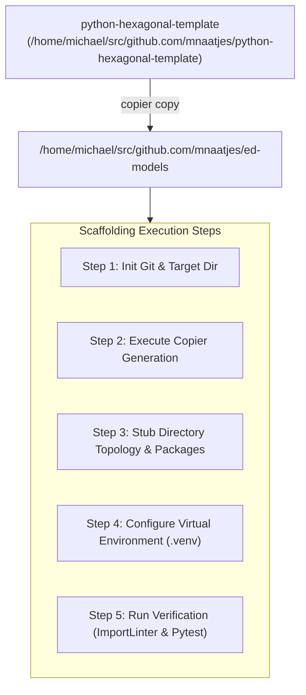

# SDD-002: ed-models Repository Scaffold and Hexagonal Setup

## 1. Executive Summary & Problem Context

In accordance with [ADR 0001](file:///home/michael/src/github.com/mnaatjes/ed-integration-smoke/architecture/adr/0001_ed_models_core_game_logic_and_catalog_architecture.md), pure Elite Dangerous game domain logic, static catalogs, and event models are decoupled into a dedicated library package: `ed-models`.

This Software Design Document (SDD) specifies the operational plan for initializing the standalone `ed-models` repository. It defines:
1. Local workspace setup conforming to Homelab Systems Lifecycle (HSL) standards (`~/src/github.com/mnaatjes/ed-models/`).
2. Scaffolding from the canonical template [`python-hexagonal-template`](https://github.com/mnaatjes/python-hexagonal-template.git) via Copier.
3. Establishing the complete Hexagonal Architecture directory topology across `core/domain/`, `core/ports/`, `core/use_cases/`, `adapters/`, and `bootstrap/`.
4. Boundary and lint configuration enforcing `HEXA-TRUTH-01` through `HEXA-TRUTH-17`.

> [!IMPORTANT]
> **Scope Boundary:** This specification governs **strictly** the repository setup, tooling bootstrap, and directory tree scaffolding. The implementation of domain logic, token normalization algorithms, event generation, and catalog data migrations is explicitly excluded.

---

## 2. Repository Topology & HSL Compliance

### 2.1 Workspace Location
In alignment with Rule 7.3 (Homelab Systems Lifecycle):
* **Target Root Path:** `/home/michael/src/github.com/mnaatjes/ed-models`
* **VCS Upstream:** `git@github.com:mnaatjes/ed-models.git` (or HTTPS equivalent)
* **Python Target:** Python 3.11+ (leveraging `enum.StrEnum` and native slots)

### 2.2 Complete Directory Scaffold Blueprint

```text
ed-models/
├── .copier-answers.yml
├── .editorconfig
├── .gemini/
│   └── rules/
│       └── hexagonal_invariants.md
├── .github/
│   └── workflows/
│       └── ci.yml
├── .gitignore
├── .importlinter
├── .pre-commit-config.yaml
├── pyproject.toml
├── README.md
│
├── src/
│   └── ed_models/
│       ├── __init__.py
│       │
│       ├── core/
│       │   ├── __init__.py
│       │   ├── domain/
│       │   │   ├── __init__.py
│       │   │   ├── exceptions.py
│       │   │   ├── types/
│       │   │   │   ├── __init__.py
│       │   │   │   ├── allegiance.py
│       │   │   │   ├── bodies.py
│       │   │   │   ├── economy.py
│       │   │   │   ├── legal.py
│       │   │   │   ├── modules.py
│       │   │   │   └── ranks.py
│       │   │   ├── spatial/
│       │   │   │   ├── __init__.py
│       │   │   │   ├── coordinates.py
│       │   │   │   └── system.py
│       │   │   ├── bodies/
│       │   │   │   ├── __init__.py
│       │   │   │   ├── star.py
│       │   │   │   └── planet.py
│       │   │   ├── ships/
│       │   │   │   ├── __init__.py
│       │   │   │   ├── hull.py
│       │   │   │   ├── module.py
│       │   │   │   └── loadout.py
│       │   │   ├── commodities/
│       │   │   │   ├── __init__.py
│       │   │   │   ├── commodity.py
│       │   │   │   ├── rare.py
│       │   │   │   └── category.py
│       │   │   ├── factions/
│       │   │   │   ├── __init__.py
│       │   │   │   ├── faction.py
│       │   │   │   └── presence.py
│       │   │   ├── status/
│       │   │   │   ├── __init__.py
│       │   │   │   └── status.py
│       │   │   ├── interop/
│       │   │   │   ├── __init__.py
│       │   │   │   ├── trade_dangerous.py
│       │   │   │   └── coriolis.py
│       │   │   └── events/
│       │   │       ├── __init__.py
│       │   │       ├── base.py
│       │   │       ├── startup.py
│       │   │       ├── travel.py
│       │   │       ├── combat.py
│       │   │       ├── exploration.py
│       │   │       ├── trade.py
│       │   │       ├── station.py
│       │   │       ├── powerplay.py
│       │   │       ├── squadrons.py
│       │   │       ├── carrier.py
│       │   │       ├── odyssey.py
│       │   │       └── other.py
│       │   │
│       │   ├── ports/
│       │   │   ├── __init__.py
│       │   │   ├── base.py
│       │   │   ├── driving/
│       │   │   │   ├── __init__.py
│       │   │   │   ├── catalog_port.py
│       │   │   │   ├── normalization_port.py
│       │   │   │   ├── event_parser_port.py
│       │   │   │   └── mechanics_port.py
│       │   │   └── driven/
│       │   │       ├── __init__.py
│       │   │       ├── ship_catalog_port.py
│       │   │       ├── module_catalog_port.py
│       │   │       └── commodity_catalog_port.py
│       │   │
│       │   └── use_cases/
│       │       ├── __init__.py
│       │       ├── lookup_ship.py
│       │       ├── lookup_module.py
│       │       ├── normalize_token.py
│       │       ├── parse_journal_event.py
│       │       ├── parse_status.py
│       │       └── calculate_jump_range.py
│       │
│       ├── adapters/
│       │   ├── __init__.py
│       │   ├── driving/
│       │   │   ├── __init__.py
│       │   │   └── facade.py
│       │   └── driven/
│       │       ├── __init__.py
│       │       └── static_catalogs/
│       │           ├── __init__.py
│       │           ├── ships.py
│       │           ├── modules.py
│       │           └── commodities.py
│       │
│       └── bootstrap/
│           ├── __init__.py
│           └── container.py
│
├── tests/
│   ├── __init__.py
│   ├── architecture/
│   │   ├── __init__.py
│   │   └── test_boundaries.py
│   ├── unit/
│   │   └── __init__.py
│   └── doubles/
│       └── __init__.py
│
└── docs/
    └── reference/
        └── hexagonal_rules.md
```

---

## 3. Scaffolding Pipeline & Execution Plan

Scaffolding uses `copier` pointing to local or remote `python-hexagonal-template`:



### Detailed Sequential Steps

#### Step 1: Initialize Target Directory
```bash
mkdir -p /home/michael/src/github.com/mnaatjes/ed-models
cd /home/michael/src/github.com/mnaatjes/ed-models
git init -b main
```

#### Step 2: Copier Invocation & Answer Mapping
Apply `python-hexagonal-template` non-interactively using predefined copier answers:

```bash
copier copy \
  --trust \
  --data package_name="ed_models" \
  --data project_name="ed-models" \
  --data project_description="Pure hexagonal domain models, game-logic calculators, and static catalogs for Elite Dangerous fleet integrations" \
  --data author_name="Michael Naatjes" \
  --data python_version="3.11" \
  /home/michael/src/github.com/mnaatjes/python-hexagonal-template \
  /home/michael/src/github.com/mnaatjes/ed-models
```

#### Step 3: Establish Subpackage Scaffold
Stub the missing domain, port, use-case, and adapter packages defined in ADR 0001 Section 4.8:

```bash
# Domain directories
mkdir -p src/ed_models/core/domain/types \
         src/ed_models/core/domain/spatial \
         src/ed_models/core/domain/bodies \
         src/ed_models/core/domain/ships \
         src/ed_models/core/domain/commodities \
         src/ed_models/core/domain/factions \
         src/ed_models/core/domain/status \
         src/ed_models/core/domain/interop \
         src/ed_models/core/domain/events

# Port directories
mkdir -p src/ed_models/core/ports/driving \
         src/ed_models/core/ports/driven

# Use cases
mkdir -p src/ed_models/core/use_cases

# Adapters
mkdir -p src/ed_models/adapters/driving \
         src/ed_models/adapters/driven/static_catalogs

# Test suite directories
mkdir -p tests/architecture tests/unit tests/doubles

# Seed __init__.py files across all created modules
find src/ed_models tests -type d -exec touch {}/__init__.py \;
```

#### Step 4: Python Virtual Environment & Tooling
```bash
python3.11 -m venv .venv
.venv/bin/pip install --upgrade pip
.venv/bin/pip install -e ".[dev]"
```

#### Step 5: Verification & Boundary Conformance
Run the hexagonal boundary tests to guarantee template purity out-of-the-box:

```bash
.venv/bin/pytest tests/architecture/test_boundaries.py
.venv/bin/ruff check .
.venv/bin/mypy src/ tests/
```

---

## 4. Architectural Invariant Governance (`.importlinter`)

The generated repository preserves strict architectural layer decoupling. The `.importlinter` configuration enforces the direction of dependencies:

```ini
[importlinter]
root_package = ed_models

[importlinter:contract:1]
name = "Hexagonal layers"
type = "layers"
layers =
    ed_models.bootstrap
    ed_models.adapters
    ed_models.core.use_cases
    ed_models.core.ports
    ed_models.core.domain

[importlinter:contract:2]
name = "Domain isolation"
type = "forbidden"
source_modules =
    ed_models.core.domain
forbidden_modules =
    ed_models.core.ports
    ed_models.core.use_cases
    ed_models.adapters
    ed_models.bootstrap
```

---

## 5. Verification Checklist

- [ ] Directory `/home/michael/src/github.com/mnaatjes/ed-models` created with initialized Git repository on branch `main`.
- [ ] Copier template executed successfully without leftover template markers (`{{ ... }}`).
- [ ] All directories and `__init__.py` stubs created under `src/ed_models/`.
- [ ] `.venv` initialized with dev dependencies installed (`pytest`, `ruff`, `mypy`, `import-linter`).
- [ ] `pytest tests/architecture/test_boundaries.py` passes with zero boundary violations.
- [ ] Initial commit created and tagged `v0.1.0-scaffold`.
