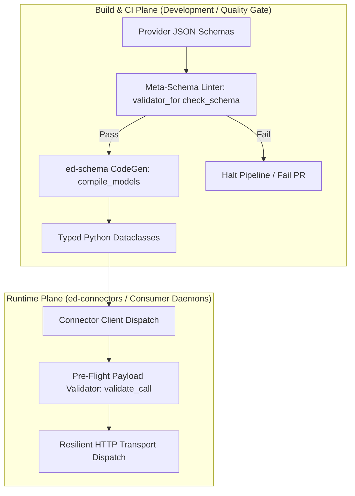

# Architectural Notes: Standard JSON Schema Meta-Validation and Multi-Dialect Governance

## 1. Executive Summary

During the synthesis and integration of third-party telemetry schemas (EDDN, Inara, and EDSM), an empirical boundary distinction was established between **schema meta-validation** (verifying that a `.json` schema file adheres to canonical JSON Schema specification rules) and **payload validation** (verifying runtime telemetry data against an ingested schema).

This note formalizes the architectural necessity, dialect differences across Elite Dangerous API targets, and deployment mechanics for automated schema meta-validation in the upcoming `ed-connectors` unified client library and `ed-schema` build pipelines.

---

## 2. Technical Analysis

### 2.1 Diagnostic: The Meta-Validation Blind Spot

In standard schema governance workflows, schemas are typically loaded using `json.loads` and passed directly into code generators (`datamodel-code-generator`) or validator registries (`SchemaEngine.register_descriptor`).

However, basic JSON parsing only guarantees syntactic JSON validity (braces, quotes, commas). It does not detect semantic JSON Schema defects such as:
1. Non-standard or misplaced keywords (e.g., placing `required` inside a property rather than the parent object).
2. Malformed `$ref` pointer expressions or unresolvable internal fragments.
3. Unsupported type constraints or invalid regex pattern formats.
4. Schema version syntax conflicts (e.g., mixing Draft-04 `id` with Draft 2020-12 `$id` or `$defs`).

In `ed-schema`, such defects can cause silent fallback passes or empty DTO dataclasses (`class ModelDTO: pass`) without raising explicit compilation errors.

---

### 2.2 Theory: Dialect Heterogeneity Across Fleet Providers

The Elite Dangerous integration fleet interfaces with disparate community-developed and commercial APIs that do not share a single JSON Schema specification:

| Provider / Target | Canonical Dialect | `$schema` URI | Structural Characteristics |
| :--- | :--- | :--- | :--- |
| **EDDN** (`eddn.edcd.io`) | **Draft 04** | `http://json-schema.org/draft-04/schema#` | Uses legacy `id`, top-level `definitions`, strict negation blocks (`{"not": {"type": [...]}}`). |
| **EDSM** (`edsm.net`) | **Draft 2020-12 / Draft 07** | `https://json-schema.org/draft/2020-12/schema` | Dereferenced object response envelopes, enum mappings, and coordinate tuples. |
| **Inara** (`inara.cz`) | **Draft 2020-12** | `https://json-schema.org/draft/2020-12/schema` | Batch RPC envelope, discriminated event arrays, strict property bounds (`additionalProperties: false`). |
| **Frontier CAPI** | **OpenAPI 3.1 / Draft 2020-12** | `https://json-schema.org/draft/2020-12/schema` | Deeply nested ship outfitting, station market arrays, and commander state. |

A static, single-version validator cannot validate all fleet schemas without falsely rejecting valid Draft-04 constructs (like EDDN's canonical schemas).

---

### 2.3 Analysis: The Plane Boundary Decoupling

Meta-schema verification must be decoupled across plane boundaries:



1. **Build & CI Plane (Heavy / Strict):** Full meta-schema validation (`jsonschema` with Draft-04 through Draft 2020-12 specifications) executes exclusively during build, testing, and CI cycles.
2. **Runtime Plane (Lean / Zero-Dependency):** Consumer daemon runtimes (`ed-telemetry`, `ed-connectors`) must not carry heavy meta-schema compilation dependencies. Runtime validation focuses strictly on verifying outbound payload dictionaries against registered schema properties.

---

### 2.4 Remediation: Deployment Architecture for `ed-connectors`

To govern schemas reliably within `ed-connectors`:

1. **Dynamic Dialect Selection:**
   Implement dialect resolution using `jsonschema.validators.validator_for(schema_dict)`:
   ```python
   import jsonschema

   validator_cls = jsonschema.validators.validator_for(schema_dict)
   validator_cls.check_schema(schema_dict)
   ```
2. **Automated CI Gating (`.github/workflows/ci.yml`):**
   Integrate the verification pattern proven in `ed-integration-smoke` (`tests/test_meta_schema_compliance.py`) into the CI workflows of `ed-connectors`. Any schema introduced or updated in `ed_connectors/providers/<target>/schemas/` must pass `check_schema` prior to triggering build-time code generation.
3. **Upstream Recommendation for `ed-schema`:**
   Expose an optional development utility on `SchemaParserPort` and `SchemaEngine`:
   ```python
   def verify_schema_meta(self, schema_dict: dict[str, Any]) -> tuple[SchemaValidationError, ...]
   ```
   This allows provider authors to assert meta-schema compliance directly through the native `ed-schema` facade during local development without custom test harnesses.
