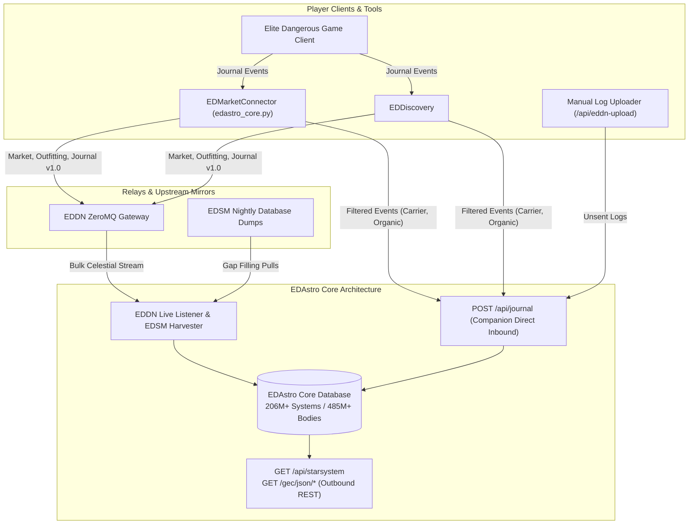

# EDAstro API and Data Ingestion Architecture

## 1. Executive Summary

Elite Dangerous Astrometrics (EDAstro) serves as the primary cartographic visualization and fleet carrier tracking service across the player fleet. 

Unlike central relays (such as EDDN) or bilateral commander profile mirrors (such as Inara and EDSM), EDAstro utilizes a **hybrid dual-channel ingestion topology**:
1. **Passive EDDN & EDSM Ingestion:** Bulk celestial exploration data (stars, planets, rings, atmospheric compositions, system coordinates) is ingested continuously via the public EDDN ZeroMQ firehose and nightly EDSM gap-fill dumps. EDAstro does not expose a general exploration upload API.
2. **Direct Companion Journal Ingestion:** A targeted HTTP POST API (`/api/journal`) receives selected low-volume raw Frontier journal events streamed directly from companion desktop clients (EDMC and EDDiscovery) to capture domain metrics not covered by EDDN schemas (e.g., Fleet Carrier logistics, Odyssey exobiology genetic scans, codex discoveries).
3. **Public Outbound Data & GEC Services:** A rate-limited REST API provides programmatic access to star system contents and the Galactic Exploration Catalog (GEC) points of interest.

---

## 2. Ingestion Topology Architecture



---

## 3. Inbound API & Ingestion Endpoints

Inbound data flow to EDAstro operates via two distinct paths: direct HTTP ingestion for companion tools and asynchronous stream harvesting for galaxy cartography.

| Endpoint / Stream | HTTP Method / Protocol | Auth / Headers | Rate Limit | Ingested Data Model | Operational Scope & Target Events |
|---|---|---|---|---|---|
| `https://edastro.com/api/journal` | `POST` | `Content-Type: application/json`<br>`User-Agent: EDMC-EDAstro/<version>` | Unrestricted for recognized companion clients | Raw Frontier Journal JSON event stream (whitelisted subset) | **Companion Direct Stream (EDMC / EDD):** Ingests events omitted or delayed by EDDN schemas: `CarrierJumpRequest`, `CarrierStats`, `FSSDiscoveryScan`, `FSSAllBodiesFound`, `ScanOrganic`, `CodexEntry`. All personal PII (Commander name, credits) is scrubbed client-side before transmission. |
| `https://edastro.com/api/eddn-upload` | `POST` (Multipart / Form) | Session cookie / Web UI | Manual submission throttle | Raw Journal log files (`.log`) | **Manual Explorer Backfill:** Allows commanders to manually upload historical or offline journal logs to recover missed carrier jumps or uncatalogued systems. |
| `tcp://eddn.edcd.io:9500` | ZeroMQ Subscriber (`tcp`) | None (Public anonymous stream) | Real-time continuous stream | `https://eddn.edcd.io/schemas/journal/1` (Draft 07 Schema) | **Bulk Galaxy Harvester:** Asynchronous passive consumption of star/planet scans, rings, materials, and system coordinates generated by the wider community. |
| `https://www.edsm.net/dump/` | `GET` (Batch HTTP) | None (Public nightly archives) | Periodic batch pull (every few days) | EDSM System & Body JSON dumps (`systemsWithCoordinates.json.gz`) | **Disaster Recovery & Gap-Fill:** Reconciles drops or downtime in the live EDDN firehose against EDSM's consolidated galaxy ledger. |

### 3.1 Companion Journal Whitelist & Transmission Envelope

EDMC enforces a strict client-side field whitelist in `plugins/edastro_core.py` (`this.event_filters`) to ensure zero transmission of PII or superfluous journal telemetry. Only the following three event types are processed:

| Event Type | Permitted Keys (Whitelisted Subset) | Dropped / Redacted Fields |
|---|---|---|
| `CarrierStats` | `timestamp`, `event`, `Callsign`, `Name`, `CarrierID`, `AllowNotorious`, `PendingDecommission`, `DockingAccess`, `FuelLevel`, `Crew` | `Finance` (Balance, Reserve, TaxRate), `SpaceUsage`, Commander identity |
| `CarrierJumpRequest` | `timestamp`, `event`, `SystemName`, `SystemAddress`, `CarrierID`, `Body`, `BodyID`, `DepartureTime` | Any player-specific context or jump fuel costs |
| `ScanOrganic` | `timestamp`, `event`, `ScanType`, `Genus`, `Genus_Localised`, `Species`, `Species_Localised`, `Variant`, `Variant_Localised`, `SystemAddress`, `Body` | First-discoverer commander token, reward payouts |

#### Client Transmission Envelope

Each qualifying event is encapsulated inside a 2-element JSON array containing an application metadata header and the pruned journal event dictionary:

```json
[
  {
    "appName": "EDAstro",
    "odyssey": true,
    "system": "Colonia"
  },
  {
    "timestamp": "2026-10-31T15:58:00Z",
    "event": "CarrierJumpRequest",
    "SystemName": "Eol Prou RS-T d3-94",
    "SystemAddress": 7268391823912,
    "CarrierID": 3700012345,
    "Body": "Eol Prou RS-T d3-94 1",
    "BodyID": 2,
    "DepartureTime": "2026-10-31T16:15:00Z"
  }
]
```

---

## 4. Outbound API Endpoints (Data Access & GEC)

EDAstro exposes a public REST API for system queries and Galactic Exploration Catalog (GEC) points of interest. 

**Standard Rate Limit:** Enforced at **100 requests per 15-minute window** per client IP, reported via standard HTTP response headers (`X-RateLimit-Limit`, `X-RateLimit-Remaining`, `X-RateLimit-Reset`).

### 4.1 Star System Data Retrieval

| Endpoint | HTTP Method | Query Parameters | Response Data Model | Description |
|---|---|---|---|---|
| `https://edastro.com/api/starsystem` | `GET` | `q={system_name}` or `q={id64}` | Single System JSON Object: `{ "name": str, "id64": int, "coords": [x,y,z], "bodies": [...] }` | Retrieves complete celestial hierarchy, body parameters, and coordinates for a single system. |
| `https://edastro.com/api/starsystem` | `GET` | `q={sys0},{sys1},...` (Max 10) | JSON Array of System Objects: `[ { ... }, { ... } ]` | Batch lookup for up to 10 systems (names or Frontier `id64` 64-bit integer tokens). |

### 4.2 Galactic Exploration Catalog (GEC) Endpoints

The GEC API returns points of interest formatted in EDSM's GMP-JSON (Galactic Mapping Project) data standard for maximum interoperability with third-party tools.

| Endpoint | HTTP Method | Path / Query Parameters | Response Data Model | Operational Scope |
|---|---|---|---|---|
| `https://edastro.com/gec/json/all` | `GET` | None | Array of GMP POI Objects (`id`, `name`, `type`, `system`, `coordinates`, `description`) | Full dump of all community-approved GEC points of interest. |
| `https://edastro.com/gec/json/combined` | `GET` | None | Combined GEC + GMP Array (`id`, `source`, `name`, `system`, `coordinates`) | Unified catalog merging legacy EDSM GMP records with EDAstro GEC records. Note: `id` is non-unique; must be keyed by `(source, id)`. |
| `https://edastro.com/gec/json/rare` | `GET` | None | Filtered Array of GMP POI Objects | Curated catalog of anomalous or rare stellar phenomena and planetary features. |
| `https://edastro.com/gec/json/single/{POI-ID}` | `GET` | `{POI-ID}` (Integer ID) | Single GMP POI Object | Look up specific point of interest by its primary key. |
| `https://edastro.com/gec/json/id64/{id64}` | `GET` | `{id64}` (64-bit Frontier System ID) | Single GMP POI Object | Look up point of interest anchored to a specific celestial system ID. |
| `https://edastro.com/gec/json/nearest/{x}/{y}/{z}` | `GET` | Spatial coordinates `{x}/{y}/{z}` (Float) | Nearest GMP POI Object | Computes 3D Euclidean distance and returns the closest cataloged point of interest. |
| `https://edastro.com/gec/json/nearest/{x}/{y}/{z}/{minrating}` | `GET` | Spatial coordinates + `{minrating}` (Int) | Nearest GMP POI Object satisfying minimum rating | Spatial proximity search filtered by community star rating / validation score. |
| `https://edastro.com/gec/json/categories` | `GET` | None | String Array: `[ "Historical", "Planetary", ... ]` | Enumerates all active classification categories in the catalog. |
| `https://edastro.com/gec/json/stats` | `GET` | None | Statistics Object: `{ "total": int, "by_region": dict, "by_category": dict }` | Aggregated catalog counts across galactic regions and tags. |

---

## 5. Schema Contract & Client Implementation Rules

1. **Strict Client-Side PII Scrubbing:** Clients streaming to `/api/journal` must strip all authentication tokens, Frontier commander names (`Commander`), account IDs, credit balances (`Credits`), and session tokens.
2. **Dynamic Whitelist Negotiation:** EDAstro periodically updates the whitelist of ingested events (such as adding new exobiology or fleet carrier event types). Companion clients should query or mirror EDAstro's active event interest list rather than transmitting unfiltered journal dumps.
3. **Adherence to EDSM GMP Interoperability:** Downstream consumers integrating the GEC endpoints must treat `(source, id)` as a composite primary key when reading `/gec/json/combined`, as GEC IDs and EDSM GMP IDs occupy colliding numerical ranges.
