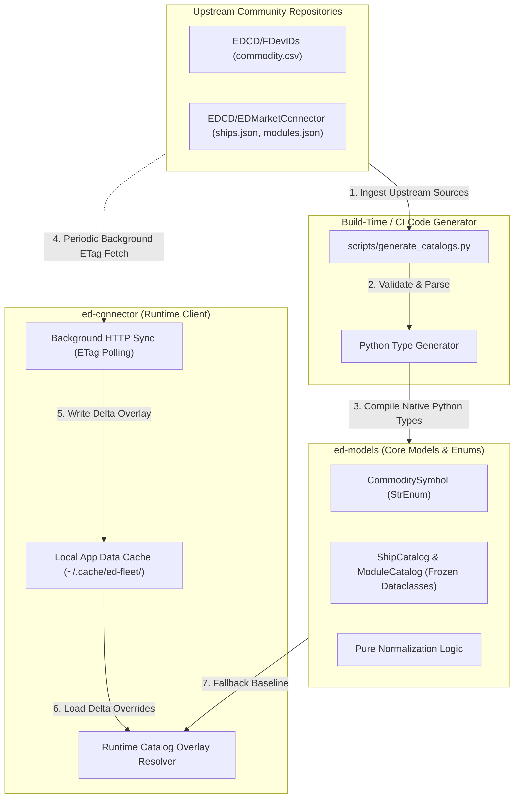
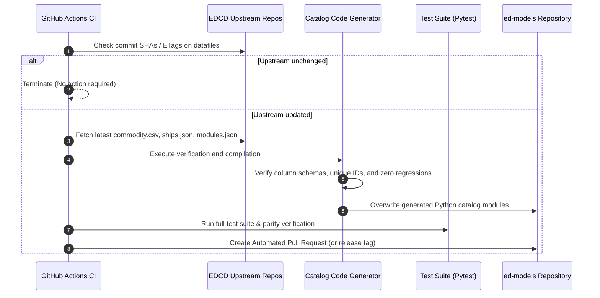

# Tier 2 Dynamic Datafiles Formalization and Update Pipeline

## 1. Executive Summary

Elite Dangerous Market Connector (EDMC) and downstream fleet tools rely on a suite of "Tier 2" static datafiles hosted across GitHub repositories (`EDCD/FDevIDs`, `EDCD/EDMarketConnector`, and `EDCD/EDMC-Plugin-Registry`). 

These assets perform three critical architectural functions:
1. **Token Normalization:** Translating opaque Frontier internal symbols (`$grain_name;`) and numeric IDs into canonical, localized English entities for market relays.
2. **Domain Specification Lookup:** Providing unlogged physical attributes (e.g., base ship hull masses, module power/mass specs, landing pad size constraints) essential for jump range and shipyard calculations.
3. **Operational Control:** Remotely enforcing fleet-wide telemetry killswitches and third-party plugin catalog distribution.

This document formalizes the integration strategy across the planned `ed-models` (core data schemas, domain models, enums) and `ed-connector` (runtime client and sync manager) packages, establishing a deterministic code generation and synchronization pipeline.

---

## 2. Inbound Datafile Inventory & Capability Matrix

| Tier 2 Asset | Upstream Canonical Source | Data Model & Semantics | Feasibility in `ed-models` / `ed-schema` | Can We Model & Execute Ourselves? | Target Allocation |
|---|---|---|---|---|---|
| **FDevIDs Commodities** | `EDCD/FDevIDs/master/commodity.csv` | Flat tabular mapping: `(id, symbol, category, name)`. Maps Frontier symbols (`$grain_name;`) to trade commodities. | Codified as `CommoditySymbol(StrEnum)` and frozen `Commodity` dataclasses. | **Yes.** Trivial in-memory dictionary lookup. | `ed-models` (Catalog) + `ed-connector` (Cache) |
| **FDevIDs Rare Commodities** | `EDCD/FDevIDs/master/rare_commodity.csv` | Tabular mapping: rare trade goods to origin market starports, systems, and max allocations. | Codified as `RareCommodityCatalog` mapping table. | **Yes.** In-memory dictionary lookup. | `ed-models` (Catalog) |
| **Outfitting Modules** | `EDCD/EDMarketConnector/.../modules.json` | Outfitting catalog mapping module IDs (`128049382`) to class, rating, mass, base price, and category. | Codified as `ShipModule` dataclass and `ModuleCatalog`. | **Yes.** Pure static dictionary lookup. | `ed-models` (Catalog) |
| **Ship Specifications** | `EDCD/EDMarketConnector/.../ships.json` | Hull specifications: ship token (`anaconda`, `cutter`), landing pad size, base hull mass, and manufacturer. | Codified as `ShipHull` dataclass and `ShipCatalog`. | **Yes.** Pure static dictionary lookup. | `ed-models` (Catalog) |
| **Dynamic Killswitches** | `EDCD/EDMarketConnector/.../killswitches_v2.json` | Operational manifest specifying event blacklists, journal version ranges, and redacted regex paths. | Draft 2020-12 schema `KillswitchRule` with predicate filtering engine. | **Yes.** Simple client-side predicate evaluation. | `ed-schema` (Contract) + `ed-connector` (Engine) |
| **Plugin Registry** | `EDCD/EDMC-Plugin-Registry/.../master_plugin_list.json` | Package manifest: plugin metadata, repository links, authors, and SHA-256 integrity hashes. | Draft 2020-12 schema `PluginManifest` and transport query client. | **Yes.** Standard HTTP fetch + schema validation. | `ed-schema` + `ed-connector` |
| **GitHub Releases** | `api.github.com/repos/EDCD/EDMarketConnector/releases` | Standard GitHub Releases REST endpoint (`tag_name`, `assets`, `published_at`). | Standard release polling logic. | **Yes.** Standard HTTP GET. | `ed-connector` |

---

## 3. Package Boundary Architecture

To ensure 100% offline availability while supporting dynamic updates when Frontier releases new game patches, the fleet splits responsibilities cleanly between `ed-models` and `ed-connector`:

### 3.1 `ed-models` Responsibilities (Static Baseline)
* **Zero Runtime Network Calls:** Ships with pre-compiled snapshots of commodities, modules, and ships directly embedded as Python code.
* **Type Safety:** Exposes `StrEnum` and frozen dataclasses, enabling full static analysis and IDE autocomplete.
* **Deterministic Normalization:** Pure functions (e.g., `normalize_commodity(token: str) -> CommodityEntity`) that operate entirely in memory.

### 3.2 `ed-connector` Responsibilities (Runtime Overlay)
* **Passive Cache Sync:** On application startup (or on a 24-hour timer), sends an HTTP `GET` with `If-None-Match` (`ETag`) to GitHub raw endpoints.
* **Local Caching:** Stores updated CSV/JSON deltas in the user's platform cache directory (e.g. `~/.cache/ed-fleet/`).
* **Runtime Overlay:** Injects updated definitions over the `ed-models` baseline dynamically, allowing the application to recognize day-one game patch items before an official library release.

---

## 4. Automated Upstream Update Pipeline

To ensure the static baseline in `ed-models` never becomes obsolete, an automated update pipeline monitors upstream repositories:

### 4.1 Verification & Linting Invariants
The generator must enforce the following validation assertions before accepting upstream changes:
1. **Schema Integrity:** Required CSV headers (`id`, `symbol`, `category`, `name`) must be present and non-empty.
2. **Identifier Uniqueness:** Numeric `id` values and string `symbol` keys must be strictly unique.
3. **No Unintended Regressions:** A diff against the existing catalog must confirm that existing symbols were not erroneously removed or corrupted.
4. **Valid Category Taxonomy:** Every commodity must map to a recognized trade category.

---

## 5. Architectural Recommendations

1. **Codify Catalogs in `ed-models`:** Eliminate raw CSV/JSON parsing from performance-critical runtime paths by embedding compiled dictionaries and enums.
2. **Encapsulate Sync in `ed-connector`:** Isolate all network polling, caching, and overlay resolution inside `ed-connector`, keeping `ed-models` free of I/O side effects.
3. **Deploy CI Update Action:** Establish a scheduled GitHub Action on `ed-models` to execute the update pipeline weekly, automatically opening dependency PRs when Frontier game updates drop.
