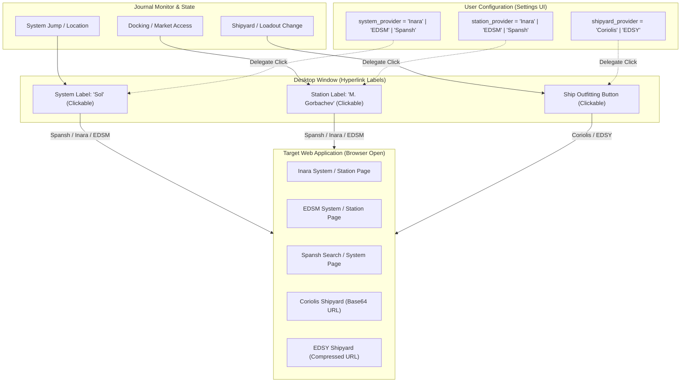

# EDMC UI Provider Selection and Desktop UX Features

## 1. Executive Summary

Beyond serving as a headless data dispatcher for EDDN and Inara, Elite Dangerous Market Connector (EDMC) provides a specialized suite of interactive desktop user experience (UX) features. 

These features bridge the local game client, local operating system window manager, and third-party web ecosystems through **UI Provider routing**, **overlay window management**, **streamer privacy redaction**, **local export triggers**, and **global hotkeys**.

This note inventories these features and maps how they should be represented across the planned `ed-models` and `ed-connector` architecture.

---

## 2. Interactive Provider Selection Architecture

EDMC decouples UI link destinations from hardcoded third-party sites using dynamic provider delegation (`plug.invoke`).

---

## 3. Inventory of Desktop UX & Operational Features

| Feature Category | Configuration Key | Mechanism | Operational Functionality |
|---|---|---|---|
| **System Provider Choice** | `system_provider` | Hyperlink delegation (`system_url`) | Lets players choose whether clicking the current star system opens **Inara**, **EDSM**, or **Spansh** in their browser. |
| **Station Provider Choice** | `station_provider` | Hyperlink delegation (`station_url`) | Lets players choose whether clicking the docked station opens **Inara**, **EDSM**, or **Spansh**. |
| **Shipyard Provider Choice** | `shipyard_provider` | Serializer + Web Import URL | Encodes current ship build and opens either **Coriolis** or **EDSY** with the full loadout populated. |
| **Alternative Shipyard Open** | `use_alt_shipyard_open` | Alternative browser handler | Toggles between direct browser navigation and operating system default protocol handlers. |
| **Window Layering / Pinning** | `always_ontop` | Window manager attribute (`-topmost`) | Keeps the EDMC window floating over the game window (vital for single-monitor borderless gaming). |
| **Window Transparency** | `theme` (`THEME_TRANSPARENT`) | Window alpha blending | Makes the background transparent, transforming EDMC into an in-game HUD overlay. |
| **System Tray Minimization** | `minimize_system_tray`, `no_systray` | OS System Tray icon | Minimizes to Windows tray / Linux system indicator on close instead of exiting. |
| **Global Hotkeys** | `hotkey_code`, `hotkey_mods`, `hotkey_mute` | OS keyboard hook (`hotkeymgr`) | Allows pressing a controller or keyboard shortcut inside the game to force an immediate market dump or toggle audio cues. |
| **Streamer Privacy Shield** | `hide_private_group`, `hide_multicrew_captain` | UI string masking | Automatically masks private group names and multicrew captain identities to prevent stream sniping. |
| **Odyssey On-Foot Row** | `update_suit_text`, `on_foot` | Dynamic UI widget toggle | Dynamically shows or hides current Odyssey suit, backpack contents, and weapon loadouts when disembarking on foot. |
| **Automated File Exports** | `output` (`OUT_MKT_FILE`, `OUT_SHIP`) | Local disk serialization | Automatically writes Trade Dangerous market files (`.td`) and E:D Shipyard plain text files on dock. |

---

## 4. Architectural Mapping to Fleet Libraries

These features break down into clean modular responsibilities:

1. **`ed-models` (Serialization & Contracts):**
   - Owns the DTO schemas and builders for **Coriolis** and **EDSY** import payloads.
   - Owns the **Trade Dangerous** `.td` text formatter.
   - Holds the enum definitions for UI providers: `SystemProvider(StrEnum)`, `StationProvider(StrEnum)`, `ShipyardProvider(StrEnum)`.

2. **`ed-connector` (URL Synthesis & OS Integration):**
   - Implements the URL builders (`SpanshUrlBuilder`, `InaraUrlBuilder`, `EdsmUrlBuilder`).
   - Implements the desktop browser dispatchers (`webbrowser.open`).
   - Manages OS hotkeys, system tray hooks, and window state preferences.
