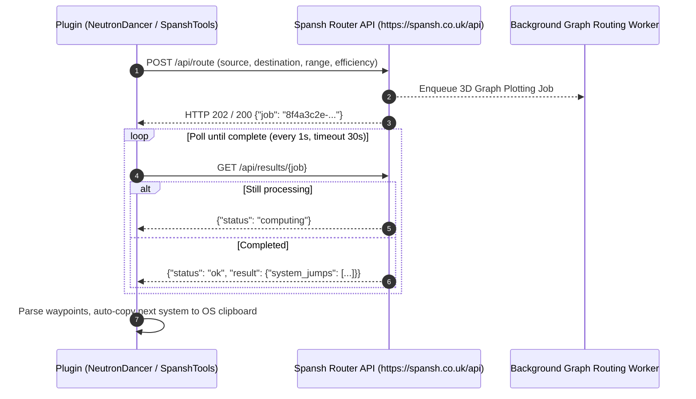

# Spansh Router APIs and Community Plugin Interop

## 1. Executive Summary

While core EDMC provides passive deep links to Spansh web pages, third-party companion plugins (`EDMC-NeutronDancer`, `EDMC-SpanshTools`, and `GalaxyGPS`) interact with Spansh via a programmatic **asynchronous job-processing REST API**.

Spansh computes computationally intensive routes (such as 3D A* graph searches across hundreds of millions of stellar systems for neutron highway plotting or fleet carrier fuel optimization) through a **2-phase job-dispatch polling pattern**:
1. **Job Dispatch (`POST /api/{router}/route`):** Client submits starting system, destination, jump range, and routing constraints. Spansh responds with a unique UUID `job` identifier.
2. **Job Polling (`GET /api/results/{job}`):** Client polls the results endpoint until computation completes (`status: "queued" | "computing" | "ok"`), returning the full multi-waypoint itinerary.

This document details Spansh's API topology, data contracts, and how the three plugins operate.

---

## 2. Spansh Router API Topology



### 2.1 Spansh API Endpoint Matrix

| Endpoint | HTTP Method | Payload / Query Parameters | Response Model | Description |
|---|---|---|---|---|
| `https://spansh.co.uk/api/route` | `POST` / `GET` | `source`, `destination`, `range`, `efficiency` | `{"job": "<uuid>"}` | **Neutron Highway Router:** Calculates optimal supercharged neutron star chain jumps. |
| `https://spansh.co.uk/api/generic/route` | `POST` / `GET` | `source`, `destination`, `range`, `cargo` | `{"job": "<uuid>"}` | **Galaxy Route Plotter:** General long-distance multi-waypoint star routing. |
| `https://spansh.co.uk/api/fleetcarrier/route` | `POST` / `GET` | `source`, `destination`, `capacity`, `tritium` | `{"job": "<uuid>"}` | **Fleet Carrier Router:** 500 LY jump increments with tritium fuel consumption and depot stops. |
| `https://spansh.co.uk/api/riches/route` | `POST` / `GET` | `source`, `destination`, `radius`, `max_systems` | `{"job": "<uuid>"}` | **Road to Riches Plotter:** High-value terraformable/water world exploration route. |
| `https://spansh.co.uk/api/exobiology/route` | `POST` / `GET` | `source`, `destination`, `radius`, `min_value` | `{"job": "<uuid>"}` | **Exobiology Router:** High-payout Odyssey organic sample route planner. |
| `https://spansh.co.uk/api/trade/route` | `POST` / `GET` | `source`, `destination`, `max_hops`, `capital` | `{"job": "<uuid>"}` | **Trade Loop Router:** Multi-hop profitable commodity loop routing. |
| `https://spansh.co.uk/api/results/{job}` | `GET` | Path parameter: `{job}` (UUID string) | Job Status or Full Route Result | **Job Status / Result Fetch:** Polls for route status (`queued`, `computing`, `ok`). |
| `https://spansh.co.uk/api/systems` | `GET` | `q={search_query}` | Array of string system names | **Typeahead Autocomplete:** Autocompletes star system names as the user types. |

---

## 3. Data Models & Payloads

### 3.1 Neutron Route Result Schema (`result.system_jumps`)

When `/api/results/{job}` returns `"status": "ok"`, the `result` object contains an array of `system_jumps` defining the journey:

```json
{
  "status": "ok",
  "result": {
    "source": "Sol",
    "destination": "Colonia",
    "range": 65.5,
    "efficiency": 60,
    "total_jumps": 88,
    "distance": 22000.45,
    "system_jumps": [
      {
        "id64": 10477373803,
        "system": "Sol",
        "x": 0.0,
        "y": 0.0,
        "z": 0.0,
        "distance_jumped": 0.0,
        "distance_left": 22000.45,
        "jumps": 0,
        "neutron_star": false
      },
      {
        "id64": 72819283719,
        "system": "Jackson's Lighthouse",
        "x": 12.5,
        "y": -145.2,
        "z": 54.0,
        "distance_jumped": 155.2,
        "distance_left": 21845.25,
        "jumps": 3,
        "neutron_star": true
      }
    ]
  }
}
```

---

## 4. Analysis of the Three Community Plugins

| Feature / Metric | `EDMC-NeutronDancer` | `EDMC-SpanshTools` | `GalaxyGPS` |
|---|---|---|---|
| **Author / Repo** | `dwomble/EDMC-NeutronDancer` | `wuuthradd/EDMC-SpanshTools` | `Fenris159/EDMC_GalaxyGPS` |
| **Primary Scope** | Dedicated in-flight Neutron and Galaxy router. | Full multi-tool suite (Riches, Exobiology, Trade, Carrier). | Lightweight route tracker and Fleet Carrier plotter. |
| **Spansh Endpoints Used** | `/api/route`, `/api/generic/route`, `/api/results`, `/api/systems` | `/api/route`, `/api/generic/route`, `/api/riches/route`, `/api/exobiology/route`, `/api/fleetcarrier/route` | `/api/route`, `/api/results`, `/api/systems` |
| **Clipboard Integration** | **Yes:** Automatically copies next system name to OS clipboard upon FSD jump completion. | **Yes:** Automatic clipboard copy on jump. | **Yes:** Automatic clipboard copy on jump. |
| **In-Game Overlay Support** | EDMCOverlay integration for head-up routing display. | Custom Tkinter / EDMCOverlay support. | Native Tkinter panel with progress bar. |
| **Local File Caching** | Saves active routes to local `routes/*.json`. | Saves route history to disk. | Saves current route state. |

---

## 5. Architectural Recommendations for the Fleet

1. **Codify Spansh Router Schemas in `ed-schema`:**
   - Define Draft 2020-12 request contracts for `SpanshRouteRequest` (`source`, `destination`, `range`).
   - Define response contracts for `SpanshJobResponse` (`job`) and `SpanshRouteResult` (`system_jumps`).
2. **Encapsulate 2-Phase Polling in `ed-transport`:**
   - Expose a polling helper method in `TransportClient` to submit the job and await the completion token cleanly without blocking the caller.
3. **Clipboard & UI Automation in `ed-connector`:**
   - Keep OS clipboard operations (`pyperclip` / OS pasteboard) and overlay rendering strictly in `ed-connector`, keeping `ed-models` and `ed-transport` pure and headless.
