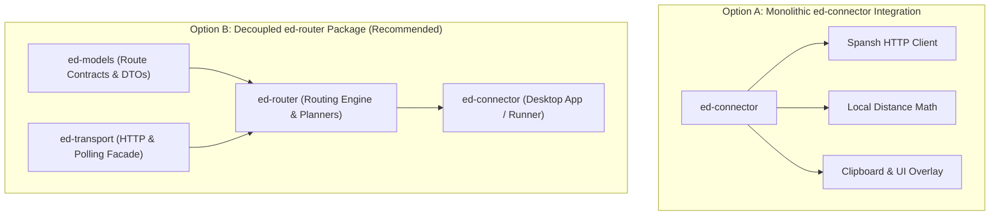

# Routing Architectures: Spansh and Future Package Allocation

## 1. Executive Summary

Pathfinding across the *Elite Dangerous* galaxy falls into distinct operational domains:
1. **Cloud-Accelerated Spatial Routing (Spansh API):** High-cost 3D graph pathfinding across hundreds of millions of stellar coordinates (e.g. neutron highway supercharging, 500 LY fleet carrier routes, Road to Riches).
2. **Deterministic Commodity Loop Routing (Trade Dangerous):** Linear programming / graph optimization to maximize profit per cargo ton across starport markets.
3. **Local Spatial & Proximity Calculation (Pure Math):** Euclidean distance calculation, spherical bounding box queries, and local waypoint sequencing.

This document evaluates whether routing should be packaged into a dedicated **`ed-router`** library or integrated into **`ed-connector`**, establishing data contracts and execution boundaries.

---

## 2. Galaxy Routing Landscape & Providers

| Domain / Provider | Execution Model | API / Engine Availability | Primary Use Case | Algorithmic Complexity |
|---|---|---|---|---|
| **Spansh Neutron Router** | Remote Cloud API (Asynchronous) | Public REST API (`/api/route`) | Supercharged neutron highway waypoint planning. | High (A* across millions of stellar coordinates). |
| **Spansh Fleet Carrier** | Remote Cloud API (Asynchronous) | Public REST API (`/api/fleetcarrier/route`) | 500 LY jump paths, tritium fuel consumption, depot stops. | High (Constrained 3D graph search + fuel math). |
| **Spansh Riches / Exobiology** | Remote Cloud API (Asynchronous) | Public REST API (`/api/riches/route`) | High-value exploration & organic sample route optimization. | High (Stellar body filtering + spatial clustering). |
| **Trade Dangerous** | Local CLI / Python Engine | Open-source Python library | Multi-hop trade loop optimization for maximum profit/ton. | Medium (Graph search across local market dumps). |
| **Local Euclidean Calculator** | In-Memory Pure Python | Native implementation | Basic jump range checks, fuel burn, next-hop sorting. | Low (Pure vector math: $\sqrt{\Delta x^2 + \Delta y^2 + \Delta z^2}$). |

---

## 3. Package Allocation Evaluation: `ed-router` vs. `ed-connector`

Two distinct architectural approaches exist for accommodating routing logic:



### Option A: Integrate Directly into `ed-connector`
* **Pros:** Fewer repositories to maintain initially; quick implementation of Spansh HTTP polling.
* **Cons:** Conflates transport client operations with routing domain logic; couples headless algorithmic routing to desktop client lifecycles; makes it difficult for headless bots, CLI tools, or external backend services to calculate routes without importing desktop connector code.

### Option B: Dedicated `ed-router` Package (Recommended)
* **Pros:**
  * **Headless Reusability:** Can be imported by CLI tools, bot frameworks, and web microservices without importing desktop application logic.
  * **Provider Pluggability:** Exposes an abstract `RoutePlanner` interface capable of switching between Spansh (cloud), local offline algorithms, and Trade Dangerous without modifying consumer code.
  * **Clean Separation of Concerns:**
    * `ed-models`: Holds `RoutePlan`, `Waypoint`, `NeutronJump`, and `CarrierSchedule` DTOs.
    * `ed-transport`: Executes the raw HTTP post-and-poll lifecycle.
    * `ed-router`: Implements path planners, route tracking, waypoint advance logic, and deviation recalculation.
    * `ed-connector`: Hooks route events to OS clipboards, desktop notifications, and window overlays.

---

## 4. `ed-router` Architectural Specification

If implemented, `ed-router` should expose a unified high-level facade:

```python
from ed_models.routing import RoutePlan, RouteRequest, RouterProvider
from ed_router import create_route_planner

planner = create_route_planner(provider=RouterProvider.SPANSH)

# Dispatches async job, polls /api/results, returns typed RoutePlan
route: RoutePlan = await planner.plan_neutron_route(
    source="Sol",
    destination="Colonia",
    jump_range=68.5,
    efficiency=60
)

# Stateful waypoint tracking during gameplay
current_waypoint = route.current_target()
route.advance_to_next()
```

---

## 5. Architectural Recommendations

1. **Short Term (MVP):** Implement Spansh DTO schemas and polling helpers in `ed-schema` and `ed-transport`. Integrate basic route tracking directly in `ed-connector` to satisfy companion tool workflows.
2. **Medium Term (Refactor to `ed-router`):** When trade routing (Trade Dangerous) or offline graph capabilities are introduced, extract the routing engine into `ed-router` as an independent domain package.
3. **Decouple OS Automations:** Ensure clipboard copy automation and overlay displays remain strictly inside `ed-connector`, keeping pathfinding logic pure and deterministic.
