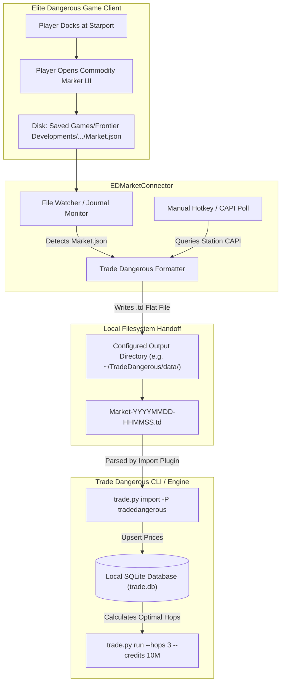

# Trade Dangerous Interop and File Export Architecture

## 1. Executive Summary

Trade Dangerous (TD) is the longest-standing commodity trade route calculator in the *Elite Dangerous* community, predating modern cloud APIs. 

Unlike web-based services (such as Inara or Spansh) that query remote hosted databases, Trade Dangerous operates as a **100% offline, local CLI engine and Python library**. To avoid redistributing hundreds of megabytes of shifting market prices inside a Python library, Trade Dangerous separates its routing algorithms from its pricing data:
1. **Engine Layer:** Static Python pathfinding and linear programming algorithms (`trade.py`), which update only when game mechanics or calculation models change.
2. **Data Layer:** A local SQLite database (`trade.db`) on the user's hard drive, populated via batch downloads, EDDN streams, or direct local file handoffs.

This note documents how EDMC interfaces with Trade Dangerous via a local filesystem-based Inter-Process Communication (IPC) handoff.

---

## 2. Filesystem-Based IPC Handoff Topology



---

## 3. Ingestion Triggers in EDMC

EDMC generates the `.td` market export via two distinct triggers:

1. **Automatic Docking Trigger (Primary):**
   * **Action:** The player docks and opens the **"Commodity Market"** interface in-game.
   * **Mechanism:** The game client writes a snapshot of all active market quotes to `Market.json` in the user's Journal directory.
   * **Execution:** EDMC's journal monitor intercepts the update, extracts commodity entries, normalizes Frontier tokens using `commodity.csv`, and writes the timestamped `.td` file to the user's configured output directory (`config.get_str('outdir')`).

2. **Manual Hotkey / Update Trigger (Secondary):**
   * **Action:** The player clicks the **"Update" button** in the EDMC UI or presses a configured global keyboard shortcut (`hotkeymgr`).
   * **Mechanism:** EDMC issues an authenticated HTTPS request to Frontier's Companion API (`/market`), obtaining the latest station market data without requiring the player to click into the in-game market screen.
   * **Execution:** The resulting payload is serialized into the same `.td` format and written to disk.

---

## 4. The `.td` Flat File Specification

The Trade Dangerous export file is a clean, tab- or space-delimited text format:

```text
# Trade Dangerous Market Export
# Generated by EDMarketConnector at 2026-10-31 18:34:00 UTC
@ System: Sol
+ Station: M. Gorbachev
$ MarketId: 128666320
# Commodity               Sell        Buy       Demand      Stock
Agronomic Treatment      3540       28500       120400          0
Gold                        0       48200            0       4520
Grain                     240        8500       540000          0
Tritium                  4500       52000        89000        120
```

* **Header Metadata:** Prefixed with `@` (System name), `+` (Station name), and `$` (Frontier MarketId).
* **Commodity Rows:** Standard normalized commodity name, station sell price (credits), station buy price (credits), market demand count, and market stock supply count.

---

## 5. Architectural Implications for Fleet Packages

1. **`ed-models` (Serialization):**
   - Owns the `TradeDangerousMarketRecord` DTO and the `.td` text serializer.
   - Converts standard market DTOs into the Trade Dangerous flat text format deterministically without disk I/O side effects.
2. **`ed-connector` (Filesystem Egress):**
   - Manages the target output folder setting (`outdir`).
   - Handles file creation, timestamped naming (`Market-YYYYMMDD-HHMMSS.td`), and write permissions.
3. **`ed-router` (Potential Local TD Integration):**
   - If offline trade optimization is needed within the fleet, `ed-router` can directly wrap Trade Dangerous's Python library or SQLite database (`trade.db`), bypassing filesystem file passing entirely.
