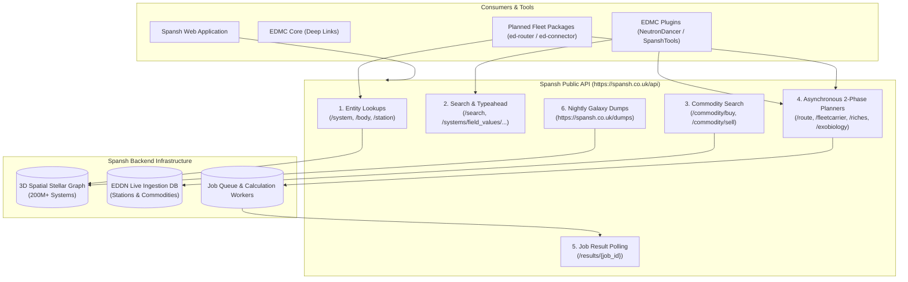

# Spansh API Ecosystem and Data Services Overview

## 1. Executive Summary

Elite Dangerous Spansh (`spansh.co.uk`) is the primary computational pathfinding and galaxy query engine in the player fleet ecosystem. 

While widely recognized for its **Neutron Highway Plotter** and **Fleet Carrier Router**, Spansh exposes a comprehensive suite of public REST and batch data services:
1. **Core Galaxy Entity APIs:** Direct lookups for Star Systems (`id64`), Celestial Bodies (`bodyId64`), and Starports (`marketId`).
2. **Search & Autocomplete:** Real-time fuzzy query and typeahead endpoints powering companion UI search inputs.
3. **Market & Trade Services:** Proximity-based commodity buy/sell searches and multi-hop trade loop calculations.
4. **Specialized Exploration Planners:** Asynchronous job-based routers for Road to Riches, Odyssey Exobiology, and Passenger Sightseeing Beacons.
5. **Nightly Galaxy Dumps:** Compressed bulk data archives (`/dumps`) of the entire known galaxy ledger.

Official documentation is hosted at [`https://docs.spansh.co.uk`](https://docs.spansh.co.uk).

---

## 2. API Service Topology

---

## 3. Comprehensive API Endpoint Reference

### 3.1 Galaxy Entity Endpoints (Synchronous REST)

| Endpoint | HTTP Method | Path / Query Parameters | Response Model | Operational Role |
|---|---|---|---|---|
| `https://spansh.co.uk/api/system/{id64}` | `GET` | `{id64}` (64-bit integer) | System JSON record (`record`) | Returns celestial body hierarchy, stations, minor factions, powerplay states, Thargoid war states, and 3D spatial coordinates. |
| `https://spansh.co.uk/api/body/{bodyId64}` | `GET` | `{bodyId64}` (64-bit integer) | Body JSON record | Returns astrophysical attributes, gravity, volcanism, atmospheric composition, rings, materials, and biological signals. |
| `https://spansh.co.uk/api/station/{marketId}` | `GET` | `{marketId}` (64-bit integer) | Station JSON record | Returns market commodity pricing, shipyard stock, outfitting modules, pad size classes, and active station services. |

### 3.2 Search & Autocomplete Endpoints

| Endpoint | HTTP Method | Query Parameters | Response Model | Operational Role |
|---|---|---|---|---|
| `https://spansh.co.uk/api/search` | `GET` | `q={query}` | Universal Search Results array | Fuzzy search matching across star systems, celestial bodies, and space stations. |
| `https://spansh.co.uk/api/systems/field_values/system_names` | `GET` | `q={prefix}` | String Array of system names | Fast typeahead autocomplete for search boxes as the user types. |

### 3.3 Commodity Trading & Market Endpoints

| Endpoint | HTTP Method | Path Parameters | Response Model | Operational Role |
|---|---|---|---|---|
| `https://spansh.co.uk/api/commodity/buy/{system}/{commodity}/{amount}` | `GET` | Reference system, commodity name, required tons | Array of selling starports | Finds nearest starports offering the specified commodity in sufficient stock. |
| `https://spansh.co.uk/api/commodity/sell/{system}/{commodity}/{amount}` | `GET` | Reference system, commodity name, cargo amount | Array of purchasing starports | Finds nearest starports offering the highest sell price and matching demand. |
| `https://spansh.co.uk/api/trade/route` | `POST` | `source`, `destination`, `max_hops`, `capital` | `{"job": "<uuid>"}` | Enqueues a multi-hop profitable trade circuit optimization calculation. |

### 3.4 Specialized Asynchronous Route Planners (2-Phase Job Pattern)

Heavy route calculations require a `POST` to enqueue, returning a UUID `job` polled via `GET https://spansh.co.uk/api/results/{job}`:

| Planner Endpoint | Target Use Case | Required Parameters | Return Structure |
|---|---|---|---|
| `https://spansh.co.uk/api/route` | **Neutron Highway:** Supercharged FSD jumps across neutron star corridors. | `source`, `destination`, `range`, `efficiency` | Array of `system_jumps` with `neutron_star: bool` flags. |
| `https://spansh.co.uk/api/fleetcarrier/route` | **Fleet Carrier Path:** 500 LY jump planning with tritium fuel consumption. | `source`, `destination`, `capacity`, `tritium` | Array of carrier jump waypoints with required tritium refuels. |
| `https://spansh.co.uk/api/generic/route` | **Galaxy Router:** General non-neutron long-distance star routing. | `source`, `destination`, `range`, `cargo` | Standard star-to-star hop itinerary. |
| `https://spansh.co.uk/api/riches/route` | **Road to Riches:** High-value exploration route through terraformable worlds. | `source`, `destination`, `radius`, `max_systems` | High-credit exploration target bodies and scan values. |
| `https://spansh.co.uk/api/exobiology/route` | **Exobiology Router:** High-payout Odyssey organic sample route planner. | `source`, `destination`, `radius`, `min_value` | Target planets containing high-value botanical genera/species. |
| `https://spansh.co.uk/api/tourist/route` | **Tourist Beacons:** Sightseeing passenger mission planning. | `source`, `destination`, `radius` | Itinerary of passenger sightseeing beacon locations. |

---

## 4. Bulk Data Dumps (`/dumps`)

For offline data science, offline routing (e.g. Trade Dangerous), and analytics, Spansh hosts daily bulk galaxy dumps at:
* **Canonical URL:** `https://spansh.co.uk/dumps`
* **Format:** Compressed JSON line archives (`.json.gz`).
* **Contents:**
  * `systems.json.gz`: Complete galaxy star systems and coordinates.
  * `bodies.json.gz`: All scanned celestial bodies and atmospheres.
  * `stations.json.gz`: All starports, outposts, surface ports, and fleet carriers.
  * `commodities.json.gz`: Daily consolidated market price ledgers.

---

## 5. Architectural Recommendations for the Fleet

1. **Model Spansh Schemas in `ed-schema`:**
   - Formalize Draft 2020-12 contracts for synchronous entity responses (`System`, `Body`, `Station`).
   - Formalize asynchronous routing request/response contracts (`RouteRequest`, `RouteResult`).
2. **Encapsulate 2-Phase Polling in `ed-transport`:**
   - Provide a specialized `poll_job(endpoint, job_id, timeout)` helper in `TransportClient` to handle asynchronous Spansh job lifecycle cleanly.
3. **Isolate Routing in `ed-router`:**
   - Allow client applications to switch between Spansh's cloud routing and local math transparently behind a common `RoutePlanner` interface.
