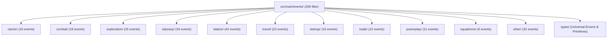

# Note 0012: Harvested Game Event Repositories & Codification Authorities

## 1. Diagnostic: Identified Event Repositories & Provenance

When engineering domain data structures for `ed-models` and ingestion pipelines for `ed-telemetry`, authoring ~150+ journal events and companion snapshot definitions by hand is error-prone. Two primary open-source reference authorities exist locally on disk:

1. **`kayahr/ed-journal` (`/home/michael/src/github.com/kayahr/ed-journal`):**
   * **Domain Role:** Pure code model and streaming parser authority.
   * **Language / Format:** TypeScript (Node.js 18+ ESM).
   * **Volume:** 269 discrete event definitions partitioned into 12 functional subdirectories.
   * **Archival Holdings:** 30 official Frontier Developments Player Journal Manual PDFs (`Journal_Manual_v1.pdf` through `Journal_Manual_v37.pdf`).

2. **`Lombra/elite-api-docs` (`/home/michael/src/github.com/Lombra/elite-api-docs`):**
   * **Domain Role:** Specification, schema documentation, and semantic authority.
   * **Language / Format:** Markdown / VitePress documentation.
   * **Volume:** 15 documentation modules totaling 7,495 lines of Markdown.
   * **Coverage:** Official FDev Journal Specification v37 (Odyssey Update 14 through modern Supercruise Overdrive SCO flags).

---

## 2. Theory: Structural Taxonomy Breakdown (`kayahr/ed-journal`)

`kayahr/ed-journal` structures 269 event models into 12 functional domains in `src/main/events/`:

### Module Breakdown Matrix

| Category Directory | Count | Core Responsibilities | Exemplar Event Types |
| :--- | :--- | :--- | :--- |
| `carrier/` | 16 | Fleet Carrier micro-economy, crew, jumps | `CarrierBuy`, `CarrierJump`, `CarrierStats`, `CarrierCrewServices` |
| `combat/` | 18 | Target locking, hull/shield degradation, PvP | `Bounty`, `Died`, `HullDamage`, `Interdicted`, `ShipTargeted` |
| `exploration/` | 26 | System scanning, DSS, biological sampling | `Scan`, `FSSDiscoveryScan`, `SAASignalsFound`, `ScanOrganic` |
| `odyssey/` | 34 | On-foot suits, weapons, lockers, missions | `Backpack`, `ShipLocker`, `BuySuit`, `UpgradeWeapon`, `Disembark` |
| `station/` | 42 | Starport docking services, engineering | `Market`, `Outfitting`, `Shipyard`, `CommunityGoal`, `EngineerCraft` |
| `travel/` | 23 | Supercruise, hyperspace, docking maneuvers | `Docked`, `FSDJump`, `Location`, `NavRoute`, `SupercruiseExit` |
| `startup/` | 16 | Session initialization and commander state | `FileHeader`, `Commander`, `LoadGame`, `Materials`, `Rank` |
| `trade/` | 10 | Commodity exchanges, deep core mining | `MarketBuy`, `MarketSell`, `MiningRefined`, `AsteroidCracked` |
| `powerplay/` | 11 | Faction alignment, voting, weekly cycles | `PowerplayJoin`, `PowerplayVote`, `PowerplaySalary` |
| `squadrons/` | 6 | Player wing & squadron governance | `SquadronStartup`, `SquadronDemotion`, `DisbandedSquadron` |
| `other/` | 32 | Status telemetry, synthesis, music, SRV | `Status`, `Music`, `Synthesis`, `ModuleInfo`, `SystemsShutdown` |
| `types/` | N/A | Primitives, star types, alignments, ranks | `Allegiance`, `StarType`, `BodyType`, `PadSize`, `CombatRank` |

### Companion Snapshot Model Specialization

`ed-journal` models standalone JSON snapshot files by extending the journal trigger event with exhaustive item payloads:

* **`ExtendedMarket` (`station/Market.ts` $\rightarrow$ `Market.json`):** Adds complete station commodity market inventory, buy/sell prices, mean price, stock, demand brackets.
* **`ExtendedOutfitting` (`station/Outfitting.ts` $\rightarrow$ `Outfitting.json`):** Adds complete module purchase inventory, FDev module IDs, and base prices.
* **`ExtendedShipyard` (`station/Shipyard.ts` $\rightarrow$ `Shipyard.json`):** Adds shipyard vessel availability catalog and base hull prices.
* **`ExtendedNavRoute` (`travel/NavRoute.ts` $\rightarrow$ `NavRoute.json`):** Adds multi-hop hyperspace route legs with 3D coordinates and star classes.
* **`ExtendedFCMaterials` (`odyssey/FCMaterials.ts` $\rightarrow$ `FCMaterials.json`):** Adds fleet carrier bartender micro-resource buy/sell allocations.

---

## 3. Analysis: Specification Nuances (`Lombra/elite-api-docs`)

`Lombra/elite-api-docs` provides the exact syntactic rules governing raw event emissions:

1. **Universal Envelope Invariant:**
   * Every line is line-delimited JSON with `timestamp` (ISO 8601 UTC) and `event` (PascalCase name).
   * First line is always `FileHeader` (historically lowercase `fileheader` in legacy versions).
2. **Localization Token Formatting:**
   * Internal string IDs follow `$symbol_name;`.
   * Translated text appears in parallel `<Key>_Localised`.
   * If localized text matches the internal symbol, `<Key>_Localised` is omitted.
3. **Status Bitfield Unpacking:**
   * Documents all 32 flags of primary `Flags` integer (docked, landed, hardpoints, shields, cargo scoop, silent running).
   * Documents secondary `Flags2` integer (Odyssey on-foot: glide mode, aim down sight, breathable atmosphere, oxygen/health low).

---

## 4. Remediation: Strategy for `ed-models` Generation

To eliminate manual codification toil while preserving ADR 0001 compliance:

1. **Source of Truth:** Use `kayahr/ed-journal/src/main/events/` as the canonical structural source for all 269 event models.
2. **TypeScript-to-Python Generation Tooling:**
   * Author an AST/regex translator script in `ed-integration-smoke/scripts/` to convert TypeScript interfaces into Python `@dataclass(kw_only=True)` structures.
   * Map TypeScript primitives: `number` $\rightarrow$ `int` / `float`, `string` $\rightarrow$ `str`, `boolean` $\rightarrow$ `bool`, `Array<T>` $\rightarrow$ `list[T]`.
3. **Verification Sandbox:**
   * Test generated models in `ed-integration-smoke` against historical journal logs in `/home/michael/src/github.com/kayahr/ed-journal/src/test/data/`.
   * Verify that parsing, hydration, and validation run with zero runtime exceptions.
