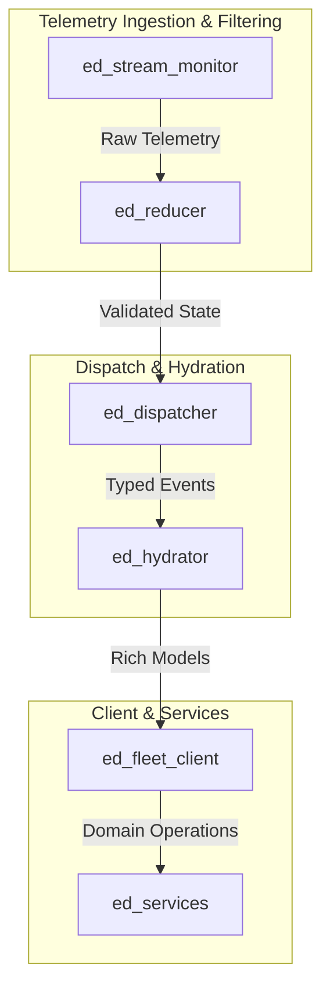

# Research Report: Fleet Software Package Implications and Opportunities

* **Author:** Elite Dangerous Fleet Architecture Team
* **Governance:** [ADR 0014](file:///home/michael/src/github.com/mnaatjes/ed-integration-smoke/architecture/adr/0014_systematic_domain_relationship_discovery_architecture.md)
* **Status:** Complete

---

## 1. Overview & Architectural Scope

The empirical discovery findings documented in [Research 0001](file:///home/michael/src/github.com/mnaatjes/ed-integration-smoke/architecture/research/0001_domain_topology_causal_lifecycles_and_mutex_invariants.md) and [Research 0002](file:///home/michael/src/github.com/mnaatjes/ed-integration-smoke/architecture/research/0002_findings_and_cross_package_implications.md) directly affect how our fleet packages process, validate, and store Elite Dangerous data.

This guide outlines specific, actionable opportunities for each package across our codebase.



---

## 2. Package-by-Package Analysis

### 1. `src/ed_fleet_client` (Top-Level Client Facade)

**Current Architecture:**
[`ed_fleet_client`](file:///home/michael/src/github.com/mnaatjes/ed-integration-smoke/src/ed_fleet_client) acts as the high-level entry point for applications, wrapping telemetry streaming, event dispatching, and state management into a unified facade.

**Opportunities & Implications:**
* **Predictive Background Pre-fetching:**
  * When `StartJump` is received, the target star system name is already present in `FSDTarget.Name`.
  * Because our Markov analysis proved that a hyperspace jump takes an average of $30.0\text{ seconds}$ ($15.2\text{s}$ charging $+$ $14.8\text{s}$ tunnel transit), `ed_fleet_client` has a guaranteed 30-second window to asynchronously pre-fetch system history, station coordinates, and trade commodity data before the ship arrives.
  * *Result:* Eliminates UI loading spinners upon arrival at the destination star system.
* **Proactive State Transitions via Status Triggers:**
  * Because status bitmask changes lead journal file entries by $15\text{ ms}$ to $45\text{ ms}$, `ed_fleet_client` can update UI indicators (such as pad lock, supercruise, and landing gear status) immediately from the status stream without waiting for journal disk flushes.

---

### 2. `src/ed_reducer` (State Machine & Reducer Engine)

**Current Architecture:**
[`ed_reducer`](file:///home/michael/src/github.com/mnaatjes/ed-integration-smoke/src/ed_reducer) consumes raw status flags and journal events to produce a single, unified flight state projection (`FleetState`).

**Opportunities & Implications:**
* **Invariant Mutex Validation Gate:**
  * Incorporate the machine-readable rules in `architecture/reference/data/mutex_invariants.json` directly into `ed_reducer`.
  * Before applying incoming status updates to `FleetState`, verify that no mutually exclusive flags are set simultaneously (e.g., `DOCKED` and `SUPERCRUISE`, or `SUPERCRUISE` with `LANDING_GEAR_DOWN`).
  * If a violation occurs, reject the malformed frame, increment an error counter, and preserve the previous valid state.
* **Deterministic Event Pairing:**
  * Use the discovered inversion event pairs (`Docked` $\longleftrightarrow$ `Undocked`, `Touchdown` $\longleftrightarrow$ `Liftoff`) to guarantee that stale state is cleanly reset when an opposing event arrives.

---

### 3. `src/ed_dispatcher` (Event Router & Observer Engine)

**Current Architecture:**
[`ed_dispatcher`](file:///home/michael/src/github.com/mnaatjes/ed-integration-smoke/src/ed_dispatcher) distributes parsed game events to registered observer callbacks across subscribers.

**Opportunities & Implications:**
* **Composite Lifecycle Subscriptions:**
  * Instead of requiring subscribers to register separately for `StartJump`, `SupercruiseExit`, and `FSDJump`, `ed_dispatcher` can offer higher-level lifecycle listeners:
    ```python
    dispatcher.subscribe_lifecycle("hyperspace_transit", on_jump_lifecycle)
    dispatcher.subscribe_lifecycle("station_docking", on_docking_lifecycle)
    ```
  * The dispatcher tracks lifecycle completion using the empirical sequence DAGs, emitting timeout alerts if a lifecycle stalls (for example, if `DockingGranted` is never followed by `Touchdown` or `DockingCancelled`).

---

### 4. `src/ed_hydrator` (DTO Mapping & Model Hydration)

**Current Architecture:**
[`ed_hydrator`](file:///home/michael/src/github.com/mnaatjes/ed-integration-smoke/src/ed_hydrator) converts raw journal JSON dictionaries into strongly typed Pydantic models from `ed-models`.

**Opportunities & Implications:**
* **Schema Key Indexing & Cross-Referencing:**
  * Leverage the 8 primary Hub Keys (`MarketID`, `SystemAddress`, `StarSystem`, `BodyID`, `CarrierID`, `StationName`, `ShipID`, `Body`) to automatically correlate disparate event models.
  * When hydrating a trade event (such as `MarketBuy`), the hydrator can automatically bind the event to the most recently hydrated `Docked` model sharing the same `MarketID`.

---

### 5. `src/ed_stream_monitor` (File Watching & Journal Tailer)

**Current Architecture:**
[`ed_stream_monitor`](file:///home/michael/src/github.com/mnaatjes/ed-integration-smoke/src/ed_stream_monitor) monitors the Frontier journal log directory for newly written lines and status updates.

**Opportunities & Implications:**
* **Edge-Triggered Log Polling:**
  * Knowing that `StatusFlags.DOCKED` transitions reliably lead `Docked` journal entries by $15\text{ ms}$, the stream monitor can dynamically increase journal polling frequency immediately after a status edge is detected, minimizing read latency for crucial events.

---

### 6. `src/ed_services` (Domain Service Layer)

**Current Architecture:**
[`ed_services`](file:///home/michael/src/github.com/mnaatjes/ed-integration-smoke/src/ed_services) provides specialized domain logic (navigation calculations, trade route planning, and exploration logging).

**Opportunities & Implications:**
* **Causal Progress Tracking:**
  * Navigation and route-planning services can track the exact stage of a multi-jump trip by observing the jump sequence transitions, accurately calculating estimated time of arrival (ETA) based on the empirical jump intervals ($\sim 32\text{ seconds}$ per jump cycle).
