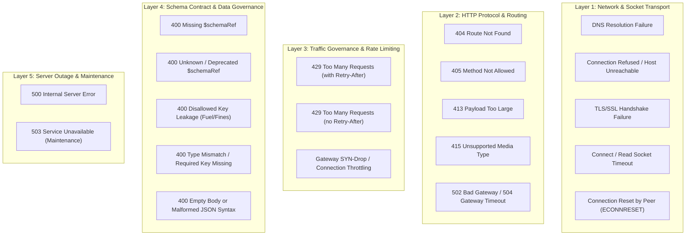

# RFC 0001: External API Failure Taxonomy, Resilience Matrix, and Simulation Architecture

## 1. Executive Summary & Problem Context

Downstream integration libraries (primarily `ed-connectors` and client daemons) dispatch telemetry and ingest live game data across third-party targets (`EDDN`, `Frontier CAPI`, `Inara`, `Spansh`). In production, remote web services exhibit non-deterministic failure patterns ranging from network connection drops to strict schema rejections and burst rate-limiting.

Without a formal, comprehensive taxonomy of failure conditions:
1. Client applications implement ad-hoc exception handling that either retries non-retryable errors (e.g., repeating a `400 Bad Request` schema failure endlessly) or drops data on recoverable errors.
2. Logging is inconsistent, omitting critical diagnostic context (such as schema reference URIs, HTTP status codes, attempt counts, or payload diffs).
3. Resilience mechanisms (offline bounded spooling in `ed-transport`, exponential backoff, circuit breaking) cannot be verified systematically because test suites only test happy-path HTTP 200 responses.

This RFC establishes:
- The authoritative 5-layer failure taxonomy across network, transport, HTTP, rate-limiting, and data governance boundaries.
- The action and resilience triage matrix for each failure mode.
- The structured diagnostic logging specification.
- The simulation implementation guide for extending `MockEddnGateway`.

---

## 2. Five-Layer External API Failure Taxonomy



---

## 3. Resilience Triage & Action Matrix

| Layer | Failure Condition | HTTP Status / Exc | Retryable? | Recommended Action | Offline Spool? | Operator Alert? |
| :--- | :--- | :--- | :--- | :--- | :--- | :--- |
| **1. Net** | DNS Resolution Failure | `socket.gaierror` | Yes | Exponential backoff (max 3) | Yes (on exhaustion) | Warning on repeated drop |
| **1. Net** | Connection Refused | `ConnectionRefusedError` | Yes | Exponential backoff (max 3) | Yes (on exhaustion) | Warning |
| **1. Net** | TLS Handshake Failure | `ssl.SSLError` | No | Halt dispatch; fail fast | No (configuration error)| Error |
| **1. Net** | Connect / Read Timeout | `TimeoutError` | Yes | Exponential backoff with jitter | Yes (on exhaustion) | Info |
| **1. Net** | Connection Reset | `ConnectionResetError` | Yes | Reconnect & retry (max 2) | Yes (on exhaustion) | Info |
| **2. HTTP**| 404 Route Not Found | HTTP 404 | No | Abort call; invalid endpoint | No (fatal config bug) | Error |
| **2. HTTP**| 405 Method Not Allowed | HTTP 405 | No | Abort call; method mismatch | No | Error |
| **2. HTTP**| 413 Payload Too Large | HTTP 413 | No | Chunk or split batch payload | No (poison message) | Warning |
| **2. HTTP**| 415 Unsupported Media | HTTP 415 | No | Check Content-Type header | No | Error |
| **2. HTTP**| 502 / 504 Bad Gateway | HTTP 502 / 504 | Yes | Retries with jitter (max 3) | Yes (on exhaustion) | Warning |
| **3. Rate**| 429 with `Retry-After`| HTTP 429 | Yes | Sleep for `Retry-After` seconds| Hold in queue | Info |
| **3. Rate**| 429 without header | HTTP 429 | Yes | Sliding window rate backoff | Hold in queue | Warning |
| **4. Data**| 400 Missing `$schemaRef`| HTTP 400 | No | Discard payload; log poison | No (poison message) | Error |
| **4. Data**| 400 Disallowed Key Leak| HTTP 400 | No | Update scrubbing filter | No (poison message) | Error |
| **4. Data**| 400 Schema Type Error | HTTP 400 | No | Reject payload; fix model | No (poison message) | Error |
| **5. Serv**| 500 Internal Error | HTTP 500 | Yes | Retries with backoff (max 2)| Yes (on exhaustion) | Warning |
| **5. Serv**| 503 Maintenance | HTTP 503 | Yes | Extended exponential backoff | Yes (immediate spool) | Info |

---

## 4. Structured Diagnostic Logging Specification

Downstream libraries (`ed-connectors`, `ed-transport`) must emit structured JSON log entries for every non-200 or retried request to enable automated telemetry triage:

### Example Log Record (Recoverable 503 Outage)

```json
{
  "timestamp": "2026-10-30T04:26:15Z",
  "level": "WARNING",
  "logger": "ed_transport.dispatch",
  "event": "http_request_retrying",
  "target": {
    "namespace": "eddn",
    "endpoint": "/upload/",
    "url": "https://eddn.edcd.io:4430/upload/"
  },
  "schema": {
    "schemaRef": "https://eddn.edcd.io/schemas/journal/1",
    "dto_class": "EddnJournalV10DTO"
  },
  "error": {
    "category": "SERVER_MAINTENANCE",
    "status_code": 503,
    "response_body": "EDDN Gateway Maintenance",
    "attempt": 1,
    "max_attempts": 3,
    "backoff_seconds": 0.69
  }
}
```

### Example Log Record (Poison Payload Schema Rejection)

```json
{
  "timestamp": "2026-10-30T04:26:20Z",
  "level": "ERROR",
  "logger": "ed_connectors.eddn",
  "event": "schema_validation_failed_upstream",
  "target": {
    "namespace": "eddn",
    "endpoint": "/upload/"
  },
  "error": {
    "category": "SCHEMA_VIOLATION",
    "status_code": 400,
    "response_body": "FAIL: Schema validation error: 'StarSystem' is a required property",
    "action": "DISCARD_POISON_PILL"
  }
}
```

---

## 5. Implementation Roadmap for `MockEddnGateway` Simulation

The `MockEddnGateway` fixture created in `ed-integration-smoke` provides the test bed for simulating these failure conditions:

1. **`simulate_status(status_code, body)`:** Already implemented for simulating 400, 404, 500, 502, 503.
2. **`simulate_rate_limit(retry_after_seconds)`:** Already implemented for simulating 429 throttling.
3. **`simulate_sequence([resp1, resp2, ...])`:** Already implemented for transient failure recovery.
4. **Planned Extensions:**
   - `simulate_network_timeout(delay_seconds)`: Pauses response past client socket timeout to trigger `TimeoutError`.
   - `simulate_disallowed_leak_rejection()`: Injects upstream EDDN regex tests checking for `_Localised` and banned status keys.
