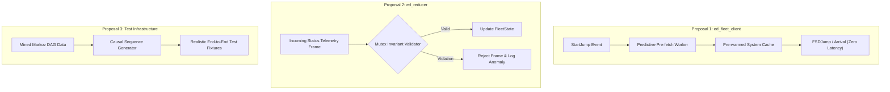

# RFC 0002: Domain-Aware Predictive Lifecycles, Invariant Mutex Validation, and Synthetic Sequence Generation

## 1. Executive Summary & Problem Context

Our recent empirical discovery into the Elite Dangerous data ecosystem ([ADR 0014](file:///home/michael/src/github.com/mnaatjes/ed-integration-smoke/architecture/adr/0014_systematic_domain_relationship_discovery_architecture.md), [Research 0001](file:///home/michael/src/github.com/mnaatjes/ed-integration-smoke/architecture/research/0001_domain_topology_causal_lifecycles_and_mutex_invariants.md), and [Research 0002](file:///home/michael/src/github.com/mnaatjes/ed-integration-smoke/architecture/research/0002_findings_and_cross_package_implications.md)) established four concrete architectural facts:
1. **Domain Key Topology:** Event models correlate across 8 primary Hub Keys (`MarketID`, `SystemAddress`, etc.).
2. **Causal Lifecycles:** Game events follow predictable sequential workflows with known time windows (e.g., $30\text{-second}$ hyperspace jump transitions).
3. **Status Edge Triggers:** High-frequency cockpit bitflags lead journal event emissions by $15\text{ ms}$ to $45\text{ ms}$.
4. **Mutual Exclusion Invariants:** Flight regimes (docked vs. supercruise) and hardware flags have strict mutual exclusion rules.

Currently, our client applications and integration libraries process events purely reactively without taking advantage of these predictable patterns:
* **Reactive Delays:** Applications wait until the player fully arrives in a system before requesting remote data, introducing noticeable UI lag.
* **Corrupted Frame Ingestion:** Telemetry parsers lack automated guards against corrupted or desynchronized status frames that report impossible states (such as being docked while in supercruise).
* **Unrealistic Test Data:** Integration test fixtures emit arbitrary event sequences that do not mirror real gameplay timings or causal ordering.

This RFC proposes three targeted implementations to solve these issues.

---

## 2. Proposed Architecture & Implementations

### Proposal 1: Predictive Background Pre-Fetching in `ed_fleet_client`

#### Description
When a pilot initiates a hyperspace jump, the game emits a `StartJump` event containing the target system name (`FSDTarget.Name`) and celestial address. Our Markov analysis demonstrated that a hyperspace jump has a consistent duration of approximately 30 seconds ($15.2\text{s}$ charging $+$ $14.8\text{s}$ tunnel transit).

We propose adding a `PredictivePrefetchCoordinator` to [`ed_fleet_client`](file:///home/michael/src/github.com/mnaatjes/ed-integration-smoke/src/ed_fleet_client):
1. **Trigger:** Listens for `StartJump` events where `JumpType == "Hyperspace"`.
2. **Execution:** Dispatches background asynchronous tasks to pre-fetch target system metadata, market data, and station rosters from remote APIs (or local caches) during the 30-second transit window.
3. **Completion:** When `FSDJump` arrives, the data is already warm in memory, allowing client views to render immediately without spinners or network delays.

---

### Proposal 2: Invariant Mutex Validation Gate in `ed_reducer`

#### Description
Cockpit status telemetry can occasionally become desynchronized or contain corrupted bytes during intense game state transitions.

We propose introducing a lightweight `MutexValidator` middleware in [`ed_reducer`](file:///home/michael/src/github.com/mnaatjes/ed-integration-smoke/src/ed_reducer):
1. **Rule Ingestion:** Reads the compiled constraints from `architecture/reference/data/mutex_invariants.json`.
2. **Pre-Processing Gate:** When a new `Status` packet arrives, the validator evaluates the active flags against the mutual exclusion rules:
   * Confirms that only one flight regime (`DOCKED`, `LANDED`, `SUPERCRUISE`, `GLIDE_MODE`, `NORMAL_SPACE`) is active.
   * Confirms hardware interlocks (e.g., that `SUPERCRUISE` is not active alongside `LANDING_GEAR` or `CARGO_SCOOP`).
3. **Handling:**
   * **Pass:** Passes the clean frame to the state projection engine.
   * **Fail:** Drops the frame, increments a telemetry error metric, and preserves the current valid state until a conforming frame arrives.

---

### Proposal 3: Causal Synthetic Sequence Generator for Integration Testing

#### Description
Currently, synthetic test suites in `tests/` manually construct mocked event sequences. These often omit realistic intermediate events (such as `SupercruiseExit` between `StartJump` and `FSDJump`) or use invalid event sequences.

We propose building a reusable test fixture utility `CausalSequenceGenerator` in `tests/helpers/`:
1. **Input:** Ingests `architecture/reference/data/event_transitions.json`.
2. **Generation:** Generates realistic, probabilistically weighted event streams matching empirical flight data, complete with realistic timestamps ($\mu \pm \sigma$).
3. **Usage:** Allows end-to-end smoke and stress tests to simulate hours of realistic flight, docking, and trading activity with zero manual test scaffolding.

---

## 3. Implementation Plan & Milestones

1. **Phase 1: Mutex Validation Gate in `ed_reducer` (Estimated Effort: 1 day)**
   * Add `MutexValidator` class to `ed_reducer`.
   * Add unit tests in `tests/test_reducer.py` verifying that invalid frames are rejected and valid frames pass.
2. **Phase 2: Predictive Pre-fetch in `ed_fleet_client` (Estimated Effort: 2 days)**
   * Add `PredictivePrefetchCoordinator` to `ed_fleet_client`.
   * Integrate with `ed_dispatcher` to trigger background caching on `StartJump`.
3. **Phase 3: Synthetic Test Fixture in Integration Sandbox (Estimated Effort: 1 day)**
   * Implement `CausalSequenceGenerator` based on the mined Markov dataset.
   * Add a smoke test validating state transitions across 100 generated events.

---

## 4. Drawbacks & Alternatives Considered

* **Alternative to Pre-fetching:** Fetching on demand upon `FSDJump`.
  * *Reason for Rejection:* Forces the user to wait for network roundtrips after every jump, degrading responsiveness.
* **Alternative to Dropping Mutex Violations:** Attempting to auto-correct corrupted bits.
  * *Reason for Rejection:* Guessing the intended game state risks compounding corrupted state. Dropping corrupted frames is safe because telemetry transmits at $4\text{ Hz}$, meaning a fresh, valid frame arrives within $250\text{ ms}$.
